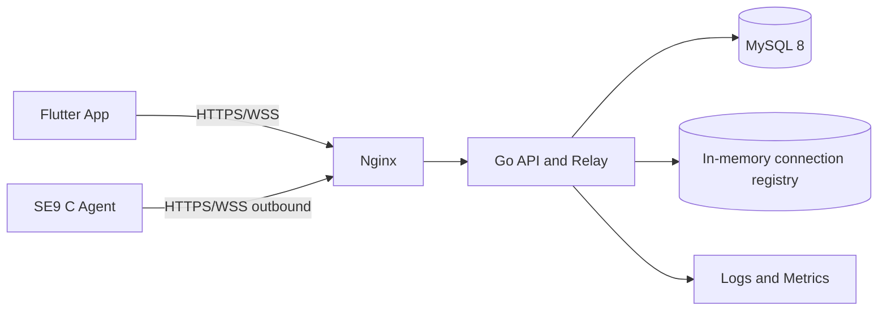
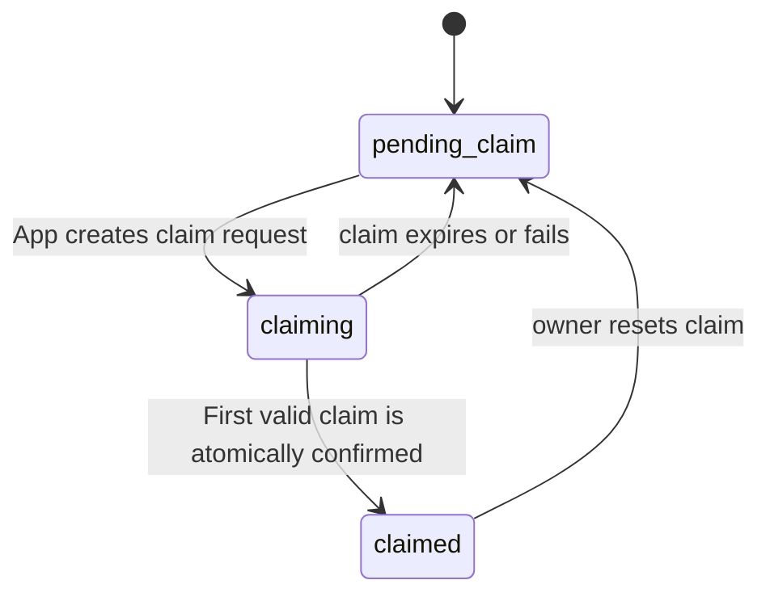

# SE9 阿里云 Go 服务器总体设计 / SE9 Alibaba Cloud Go Server Design

## 中文

### 1. 文档目标

本文档定义 SE9 项目的阿里云服务器设计，服务器使用 Go 实现，部署在阿里云上海区域，负责用户认证、设备管理、设备绑定、远程会话和数据中继。

SE9 设备端的 File API 和 Agent 使用 C，移动端使用 Flutter。本文档补充接口文档之外的工程设计内容，包括部署拓扑、数据模型、状态机、协议、安全、监控和测试要求。

### 2. 设计范围

云端 Go 服务包含：

- 用户注册、登录和 token 管理；
- 设备注册、心跳和在线状态；
- 局域网发现后的设备首次绑定；
- 绑定字符串校验和设备先到先得占用；
- App 到 SE9 的远程会话；
- App WebSocket 与设备 Agent WebSocket 的配对；
- 文件请求和分片数据中继；
- 操作日志、健康检查和监控指标。

以下功能暂不放入 Demo：

- App 到 SE9 的端到端文件加密；
- 阿里云 OSS 大文件直传；
- 多地域容灾；
- 复杂企业组织和计费系统。

### 3. 云端部署拓扑



Demo 推荐部署：

| 组件 | Demo 方案 |
| --- | --- |
| 云主机 | 阿里云 ECS，Ubuntu 22.04，上海区域 |
| 反向代理 | Nginx |
| Go 服务 | 单体 API + Relay 进程 |
| 数据库 | MySQL 8 |
| 在线连接 | Go 进程内存，后续可迁移 Redis |
| 文件对象存储 | Demo 暂不使用 OSS |
| 进程管理 | systemd |
| 外部协议 | HTTPS、WSS |

SE9 和 App 都主动连接云端，SE9 不开放公网入站端口。

### 4. 服务模块

Go 服务建议按以下模块划分：

```text
cmd/cloud/main.go
internal/auth       用户认证和 token
internal/device     设备注册、心跳、绑定
internal/session    远程会话生命周期
internal/relay      WebSocket 连接和消息转发
internal/store      MySQL 数据访问
internal/audit      审计日志
internal/httpapi    HTTP 路由、中间件和响应包络
internal/config     环境变量和配置文件
```

控制面和数据面可以先运行在同一个 Go 进程中，但代码必须保持模块边界，后续可以拆分成 API 服务和 Relay 服务。

### 5. 用户认证设计

#### 5.1 Token

```text
Access Token：有效期 1 小时
Refresh Token：有效期 30 天
密码：bcrypt 或 Argon2id
```

数据库只保存 Refresh Token 的哈希值，不保存明文 token。退出登录、修改密码和删除账号时吊销相关 token。

#### 5.2 登录规则

- 登录接口使用账号和密码；
- 连续失败达到阈值后临时锁定；
- 登录、刷新和退出操作写入审计日志；
- App 请求必须携带 `Authorization: Bearer <accessToken>`；
- WebSocket 握手必须重新验证 token，不能只信任 HTTP 会话。

### 6. 数据库模型

#### 6.1 `users`

```text
id                 bigint primary key
account            varchar(255) unique
password_hash      varchar(255)
nickname           varchar(64)
status             varchar(32)
created_at         datetime
updated_at         datetime
```

#### 6.2 `refresh_tokens`

```text
id                 bigint primary key
user_id            bigint
token_hash         varchar(128) unique
expires_at         datetime
revoked_at         datetime null
created_at         datetime
```

#### 6.3 `devices`

```text
id                 bigint primary key
device_id          varchar(128) unique
name               varchar(128)
public_key         text
device_token_hash  varchar(128)
status             varchar(32)
last_seen_at       datetime null
agent_version      varchar(64)
created_at         datetime
updated_at         datetime
```

#### 6.4 `device_bindings`

```text
id                 bigint primary key
device_id          bigint
user_id            bigint
role               varchar(32)
status             varchar(32)
bound_at           datetime
unbound_at         datetime null
```

`role` 为 `owner` 或 `member`；同一设备最多一个有效 owner。

#### 6.5 `claim_requests`

```text
id                 bigint primary key
request_id         varchar(128) unique
device_id          bigint
user_id            bigint
claim_hash         varchar(128)
status             varchar(32)
expires_at         datetime
confirmed_at       datetime null
used_at            datetime null
created_at         datetime
```

绑定字符串只保存哈希，成功使用后立即失效。

#### 6.6 `sessions`

```text
id                 bigint primary key
session_id         varchar(128) unique
device_id          bigint
user_id            bigint
status             varchar(32)
expires_at         datetime
created_at         datetime
closed_at          datetime null
```

#### 6.7 `audit_logs`

```text
id                 bigint primary key
request_id         varchar(128)
user_id            bigint null
device_id          bigint null
session_id         varchar(128) null
action             varchar(64)
result_code        varchar(32)
remote_addr        varchar(128)
created_at         datetime
```

### 7. 设备身份和注册

SE9 第一次启动时由 C Agent 生成设备密钥对：

```text
device_id
device_private_key
device_public_key
```

私钥只保存在设备本地。Agent 调用：

```text
POST /api/v2/devices/register
```

云端校验设备 ID 和公钥后返回设备 token。后续 Agent 使用设备 token 调用心跳和建立中继连接。

设备注册状态：

```text
unregistered → pending_claim → claimed
```

设备 token 可以被管理员撤销。重新注册必须经过明确的恢复流程，不能静默覆盖原设备。

### 8. 设备绑定状态机



规则：

- App 必须先在局域网发现设备；
- App 创建云端绑定请求；
- 未绑定设备收到合法请求后即可生成绑定字符串；
- 绑定字符串有效期 5～10 分钟；
- 绑定字符串只允许使用一次；
- 重复使用和过期使用统一失败；
- 一个设备最多只有一个 owner；
- 第一个成功提交的用户获得 owner，后续用户不能覆盖；
- 解除绑定不删除设备文件；
- 绑定、解除绑定和恢复绑定都记录审计日志。

### 9. 远程会话设计

会话状态：

```text
created → waiting_device → connected → closed
                              ↓
                           expired
```

创建会话时执行：

1. 校验用户是否拥有设备访问权限；
2. 检查设备最近心跳；
3. 生成随机 `session_id`；
4. 设置 10 分钟有效期；
5. 等待 App 和 Agent 两端连接；
6. 两端都认证成功后变为 `connected`。

建议 Demo 限制：

```text
单设备最大并发会话：3
单会话并发请求：4
心跳间隔：30 秒
心跳超时：90 秒
空闲会话：10 分钟
单消息最大大小：8 MiB
```

### 10. 中继协议

App：

```text
GET /api/v2/relay/app?sessionId=<id>
Authorization: Bearer <accessToken>
```

Agent：

```text
GET /api/v2/relay/device?deviceId=<id>
X-Device-Token: <deviceToken>
```

控制帧：

```json
{
  "type": "http_request",
  "sessionId": "session-001",
  "requestId": "request-001",
  "method": "GET",
  "path": "/api/v2/files?path=/videos",
  "headers": {},
  "bodyBase64": ""
}
```

响应帧：

```json
{
  "type": "http_response",
  "requestId": "request-001",
  "status": 200,
  "headers": {"Content-Type": "application/json"},
  "bodyBase64": "..."
}
```

消息类型：

```text
device_auth
device_auth_ok
session_open
session_ready
http_request
http_response
binary_chunk_start
binary_chunk
heartbeat
close
error
```

Demo 暂不做 App 到 SE9 的端到端文件加密，但 App 到云端、SE9 到云端仍使用 HTTPS/WSS。

### 11. 幂等、并发和超时

- 所有写接口接受 `requestId`；重复请求返回第一次结果；
- 设备注册按 `deviceId` 幂等；
- 心跳按设备 ID 更新，不创建重复记录；
- 绑定确认按 `claimRequestId` 幂等；
- 会话关闭可以重复调用；
- 中继请求按 `requestId` 匹配响应；
- 控制请求默认 30 秒超时；
- 上传分片由设备端负责重试和缺失查询；
- 云端不缓存整个视频文件。

### 12. 安全设计

- 外部 API 只开放 HTTPS；
- WebSocket 只开放 WSS；
- Nginx 负责 TLS 终止和请求大小限制；
- Go 服务继续校验 token，不能只依赖 Nginx；
- 设备 token 和 Refresh Token 只保存哈希；
- 绑定字符串只保存哈希；
- 限制登录、绑定、心跳和会话创建频率；
- 拒绝路径穿越、非法文件名和超大分片；
- 中继校验 App 用户、设备 token 和 session ID 的三方关系；
- 数据库、密钥和配置不提交到代码仓库；
- 日志中不得写入密码、token 或完整绑定字符串。

### 13. 阿里云部署

建议目录：

```text
/opt/se9-cloud/bin/se9-cloud
/opt/se9-cloud/config/config.yaml
/var/log/se9-cloud/
```

systemd 服务至少包含：

```text
After=network-online.target
Restart=always
RestartSec=3
EnvironmentFile=/etc/se9-cloud.env
```

Nginx 需要转发：

```text
/api/              → Go HTTP API
/api/v2/relay/     → Go WebSocket Relay
```

部署必须配置：

- 域名和 TLS 证书；
- ECS 安全组只开放 80/443；
- MySQL 仅允许 Go 服务访问；
- SSH 仅允许管理 IP；
- 数据库每日备份；
- Go 服务健康检查和自动重启。

### 14. 监控和日志

每条请求记录：

```text
request_id
user_id
device_id
session_id
route
status_code
business_code
latency_ms
remote_addr
```

必须监控：

- 登录失败率；
- 在线设备数；
- 设备心跳超时数；
- 活跃会话数；
- 中继连接数；
- 上传失败率；
- WebSocket 断开率；
- MySQL 连接池；
- ECS CPU、内存和磁盘。

### 15. 测试计划

#### 单元测试

- token 生成和验证；
- 密码校验；
- 绑定状态转换；
- 会话过期；
- 消息路由；
- 幂等请求。

#### 集成测试

- App 登录到创建会话；
- Agent 注册到心跳；
- App/Agent WebSocket 配对；
- 文件列表通过中继到达设备；
- 分片上传中断后恢复；
- 设备离线和重连。

#### 安全测试

- token 重放；
- 绑定字符串重放；
- 越权访问设备；
- 路径穿越；
- 超大请求；
- WebSocket 未授权连接；
- 登录暴力破解。

### 16. Demo 完成标准

阿里云 Go 服务器达到以下条件后，才可进入 App 和 SE9 联调：

- 用户可以登录并获取 token；
- SE9 Agent 可以注册并发送心跳；
- App 可以查询设备列表；
- App 可以创建访问会话；
- App 和 Agent WebSocket 可以配对；
- 控制帧可以双向转发；
- 设备离线会返回明确错误；
- 会话过期后连接会被关闭；
- 所有关键动作有 request ID 和审计日志；
- 服务可以通过 systemd 在阿里云 ECS 自动重启。

## English

### 1. Document Goal

This document defines the Alibaba Cloud server design for SE9. The server is implemented in Go and deployed in the Alibaba Cloud Shanghai region. It provides user authentication, device registration, device claiming, remote sessions, and data relay.

The File API and Agent on SE9 are implemented in C, while the mobile client is implemented in Flutter. This document covers the engineering design beyond the API list: deployment, data models, state machines, protocols, security, observability, and testing.

### 2. Scope

The Go service provides account management, device registration and heartbeats, first claiming after local discovery, atomic claim-string verification, remote sessions, app/device WebSocket pairing, file-request and chunk relay, audit logs, health checks, and metrics.

End-to-end file encryption, OSS direct transfer, multi-region disaster recovery, and complex enterprise billing are deferred from the demo.

### 3. Deployment Topology


The demo uses an Alibaba Cloud ECS instance with Ubuntu 22.04, Nginx, one Go API/Relay process, MySQL 8, in-memory online connections, systemd, HTTPS, and WSS. OSS is deferred. Both SE9 and the app initiate outbound connections; SE9 exposes no public inbound port.

### 4. Service Modules

The Go service should be organized into `auth`, `device`, `session`, `relay`, `store`, `audit`, `httpapi`, and `config` modules. Control-plane and data-plane code may run in one process for the demo but must keep clear module boundaries.

### 5. Authentication

Use one-hour access tokens, 30-day refresh tokens, and bcrypt or Argon2id password hashes. Store only refresh-token hashes. Revoke tokens on logout, password changes, and account deletion. Authenticate WebSocket handshakes independently from HTTP requests.

### 6. Database Model

The minimum tables are `users`, `refresh_tokens`, `devices`, `device_bindings`, `claim_requests`, `sessions`, and `audit_logs`. Device IDs, account IDs, token hashes, claim hashes, session IDs, timestamps, status fields, and relevant indexes must be persisted. A device has at most one active owner.

### 7. Device Identity and Registration

On first boot, the C Agent creates a device ID and key pair. The private key stays on the device. The public key is registered through `POST /api/v2/devices/register`; the cloud returns a device token. The token is used for heartbeats and the relay connection. Device tokens can be revoked and re-registration must be explicit.

### 8. Claim State Machine

```text
unregistered → pending_claim → claiming → claimed
```

The app must discover the device locally before creating a claim request. An unclaimed device creates a one-time claim string valid for 5–10 minutes and sends it to the app through the encrypted UDP pairing channel. The cloud confirms it with an atomic first-claim operation; the string is single-use and stored only as a hash. Later users receive an already-claimed error. Unbinding does not delete device files.

### 9. Remote Sessions

Session states are `created`, `waiting_device`, `connected`, `closed`, and `expired`. On creation, the cloud checks device access, the latest heartbeat, creates a random session ID, and sets a 10-minute expiry. The demo limits one device to three concurrent sessions, one session to four concurrent requests, uses 30-second heartbeats, and closes connections after 90 seconds without a heartbeat.

### 10. Relay Protocol

The app connects to `/api/v2/relay/app?sessionId=...` with a user token. The Agent connects to `/api/v2/relay/device?deviceId=...` with a device token. JSON control frames contain a type, session ID, request ID, method, path, headers, and an optional Base64 body. Responses contain the request ID, status, headers, and body. Binary frames may carry upload chunks after a metadata frame. End-to-end encryption is deferred, but App-to-cloud and SE9-to-cloud connections use HTTPS/WSS.

### 11. Idempotency and Timeouts

All write operations accept a request ID. Device registration, heartbeats, claim confirmation, and session close are idempotent. Relay requests use request IDs to match responses. Control requests time out after 30 seconds. The cloud does not cache entire video files.

### 12. Security

Expose only HTTPS and WSS. Nginx terminates TLS and applies request limits, while Go still validates tokens. Store only token and claim hashes. Rate-limit login, claim, heartbeat, and session creation. Reject path traversal, invalid names, oversized chunks, unauthorized WebSocket connections, and mismatched user/device/session relationships. Never log passwords, tokens, or full claim strings.

### 13. Alibaba Cloud Deployment

Use `/opt/se9-cloud/bin/se9-cloud`, `/opt/se9-cloud/config/config.yaml`, and `/var/log/se9-cloud/`. Run the Go service with systemd and automatic restart. Nginx forwards `/api/` to HTTP APIs and `/api/v2/relay/` to WebSocket Relay. Configure DNS, TLS, ECS security groups, restricted MySQL access, restricted SSH, daily database backups, and health checks.

### 14. Observability

Log request ID, user ID, device ID, session ID, route, status, business code, latency, and remote address. Monitor login failures, online devices, heartbeat timeouts, active sessions, relay connections, upload failures, WebSocket disconnects, MySQL pool usage, and ECS CPU, memory, and disk.

### 15. Testing

Unit-test token validation, password checks, claim state transitions, session expiry, message routing, and idempotency. Integration-test login-to-session creation, Agent registration and heartbeats, WebSocket pairing, relay file listing, resumable uploads, offline devices, and reconnects. Security-test token replay, claim replay, device authorization, path traversal, oversized requests, unauthorized WebSocket access, and brute-force login.

### 16. Demo Completion Criteria

The Go server is ready for App/SE9 integration when users can log in, the Agent can register and send heartbeats, the app can list devices and create sessions, both WebSocket channels can pair, control frames can be relayed bidirectionally, offline and expired sessions return explicit errors, key actions have request IDs and audit logs, and systemd can restart the service automatically on Alibaba Cloud ECS.
