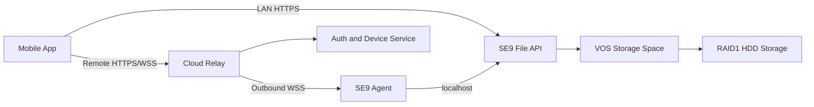

# SE9 Mobile File Management Project Design / SE9 移动文件管理项目总体设计

## 中文

### 1. 项目概述

本项目为 SE9 H16-A4-42-10 设备建设一套移动端文件管理能力。用户通过手机 App 将图片和视频上传到 SE9，并管理设备中的文件；App 同时支持局域网访问和远程网络访问。

SE9 预装 Ubuntu 22.04 和 VOS 系统，具备 WebUI 文件管理、用户权限、文件上传下载、文件分享、USB 外部设备和应用扩展能力。设备没有 Wi-Fi，主要通过有线以太网接入网络；设备可通过 HDMI 显示本地信息。VOS 现有能力可作为存储和权限基础，但面向第三方 App 的正式 API 仍需确认。

### 2. 目标与范围

#### 2.1 目标

- 提供 iOS/Android 移动 App。
- 上传图片、视频及其他常用文件。
- 浏览、搜索、预览、下载、重命名、移动和删除文件。
- 支持断点续传、后台上传和弱网重试。
- 支持同一局域网和远程网络访问。
- 支持一个设备绑定一个所有者，并可扩展成员权限。
- 不要求用户安装 Tailscale 或 WireGuard 等独立 VPN App。

#### 2.2 第一阶段不包含

- 视频内容分析和 AI 识别。
- 多路视频转码能力保证。
- 复杂的企业级组织架构。
- 直接把 SMB 作为移动端主要访问协议。

### 3. 总体架构



系统由五类组件组成：

1. **移动 App**：负责用户交互、设备发现、登录、文件操作和上传任务。
2. **SE9 File API**：提供目录和文件接口，运行在设备本机，访问 VOS 存储空间。
3. **SE9 Agent**：设备连接代理，负责设备注册、长连接、绑定确认和中继数据转发。
4. **Cloud Relay**：云端认证、设备管理、会话配对和安全中继。
5. **VOS/Storage**：保留 VOS 的存储空间、用户和文件权限能力。

### 4. 网络访问策略

#### 4.1 局域网访问

SE9 通过网线连接路由器，手机通过同一路由器的 Wi-Fi 或移动热点接入同一局域网。App 使用 UDP 广播发现设备并通过 UDP 单播完成握手；发现成功后，文件数据仍通过设备局域网 IP 上的 HTTPS File API 传输。UDP 只承担发现、能力协商和绑定请求，不承载文件内容。

局域网访问不依赖云端中继，适合大文件和高速传输。App 应在发现后通过设备签名或证书校验设备身份，避免只相信 IP 地址。File API 在局域网模式下监听设备局域网地址；远程模式下仍只监听 `127.0.0.1`，由 Agent 转发。

#### 4.3 局域网 UDP 发现协议

UDP 使用固定端口 `37020`，消息编码为 UTF-8 JSON，单个 UDP 数据报不超过 1200 字节。所有消息包含以下公共字段：

```json
{
  "version": 1,
  "type": "discover_request",
  "requestId": "16-byte-random-hex",
  "timestamp": 1788768000000,
  "nonce": "32-byte-random-hex",
  "body": {}
}
```

设备只接受时间偏差不超过 5 分钟、`requestId` 未处理过且 `nonce` 未重放的请求。响应中增加 `deviceId`、`signature` 和 `serverTimestamp`；`signature` 使用设备长期私钥对 `version || type || requestId || timestamp || nonce || body` 的规范化 JSON 做 Ed25519 签名。

消息类型如下：

| 类型 | 方向 | 用途 |
|---|---|---|
| `discover_request` | App → 广播地址 | 请求局域网设备回应 |
| `discover_response` | 设备 → App 单播 | 返回设备 ID、IP、HTTPS 端口、版本、公钥指纹和状态 |
| `handshake_request` | App → 设备单播 | 用 nonce 和设备签名确认身份，协商 `apiBase=/api/v2` |
| `handshake_response` | 设备 → App 单播 | 返回短期 `lanSessionId`、过期时间和 File API 地址 |
| `pairing_request` | App → 设备单播 | 发起绑定请求并提交 App 临时公钥 |
| `pairing_status` | App ↔ 设备单播 | 查询绑定状态；未绑定设备返回加密绑定字符串 |
| `pairing_result` | 设备 → App 单播 | 返回加密的一次性绑定字符串 |
| `goodbye` | App → 设备单播 | 主动结束发现会话 |
| `error` | 设备 → App 单播 | 返回错误码和可重试提示 |

设备响应示例：

```json
{
  "version": 1,
  "type": "discover_response",
  "requestId": "same-request-id",
  "timestamp": 1788768000123,
  "serverTimestamp": 1788768000123,
  "deviceId": "se9-001",
  "body": {
    "name": "客厅 NAS",
    "httpsPort": 8443,
    "apiBase": "/api/v2",
    "claimStatus": "pending_claim",
    "publicKeyFingerprint": "sha256:...",
    "capabilities": ["files", "upload", "download"]
  },
  "signature": "base64-ed25519-signature"
}
```

UDP 流程：

```text
1. App 绑定本地 UDP 临时端口，向 255.255.255.255:37020 发送 discover_request。
2. 设备在 1 秒内返回 discover_response；App 按 deviceId 去重，最多重试 3 次。
3. App 校验时间、nonce、设备公钥指纹和签名；签名失败的响应直接丢弃。
4. App 向设备单播 handshake_request，携带 App nonce、设备 nonce 和能力列表。
5. 设备校验请求后返回短期 lanSessionId，默认有效 10 分钟。
6. App 使用 HTTPS 访问 `https://<device-ip>:8443/api/v2`，请求头携带 `X-LAN-Session-ID` 和用户访问令牌。
7. 未绑定设备立即通过 UDP 单播发送加密的 `pairing_result`；文件列表、上传、下载、预览全部走 HTTPS。
8. 连续 3 次超时后，App 标记设备不可达并回退到云端远程会话。
```

绑定字符串交换规则：App 在 `handshake_request` 中提交临时 X25519 公钥，设备在 `handshake_response` 中返回自己的临时 X25519 公钥，并用设备长期 Ed25519 私钥签名整个握手 transcript。双方使用 X25519 派生会话密钥，再使用 AES-256-GCM 或 ChaCha20-Poly1305 加密 `claimString`。绑定字符串只通过设备到 App 的单播发送，不能出现在广播包、日志或明文 UDP 包中；解密后 App 立即通过 HTTPS `/api/v2/devices/claim/confirm` 提交，服务端成功后立即使其失效。

UDP 不能保证送达、顺序或不重复。发现请求允许重复，绑定请求和绑定字符串确认必须通过 `requestId` 幂等；设备不在 UDP 中传输文件、密码或长期 token。

#### 4.2 远程访问

远程访问采用安全中继，不要求 SE9 拥有公网 IP，也不要求路由器进行入站端口映射：

```text
SE9 Agent --outbound WSS--> Cloud Relay <--WSS-- Mobile App
```

SE9 Agent 和 App 都主动连接云端。云端按 `session_id` 将两个连接配对并转发数据。SE9 的文件 API 只监听本机回环地址，不能直接从公网访问。

### 5. 设备身份与绑定流程

#### 5.1 设备身份

设备首次启动时生成长期设备密钥对和 `device_id`。私钥保存在设备本地，公钥注册到云端。设备向云端注册后状态为 `pending_claim`，表示已上线但尚未绑定用户。

#### 5.2 局域网发现和首次绑定

1. SE9 通过有线网络上线并连接云端。
2. 手机 App 在局域网中发现处于 `pending_claim` 的设备。
3. 用户在 App 中选择“添加设备”。
4. App 向设备发送绑定请求和临时公钥。
5. 设备检查自身仍为 `pending_claim`，生成一次性绑定字符串并通过加密 UDP 单播返回。
6. App 解密绑定字符串后提交云端。
7. 云端以原子操作确认设备仍未绑定，并将设备绑定到当前用户。
8. 第一个成功提交的用户成为 `owner`，设备状态改为 `claimed`。
9. 其他用户的绑定请求统一返回“设备已绑定”，不覆盖已有 owner。

绑定字符串在未绑定设备收到合法请求后生成，不在每次开机时生成。建议有效期 5 至 10 分钟、只能使用一次、连续输错后失效。设备是否已绑定以云端持久化状态为准，设备端不能自行覆盖 owner。

#### 5.3 无 HDMI 时的备用方式

可以手动输入设备 IP，或使用设备标签上的短期激活码辅助发现。设备标签上的代码不应永久有效，首次绑定后必须失效；已绑定设备必须通过 owner 发起解绑或重置后才能再次绑定。

### 6. 云端会话配对

设备 Agent 启动后保持一条经过 TLS 的设备长连接。App 登录后请求访问指定设备，云端检查用户权限并创建短期 `session_id`。

```text
1. Device Agent -> Relay: device_auth
2. App -> Relay: user_auth
3. App -> Relay: create_session(device_id)
4. Relay -> Device Agent: open_session(session_id)
5. Device Agent -> Relay: session_accept
6. App -> Relay: open_data_channel(session_id)
7. Relay: map app connection and device connection
```

中继服务只允许同一 `session_id` 的两端互相转发。会话过期、用户退出、设备离线或管理员撤销设备时，云端删除会话映射。

### 7. 文件 API 设计

建议 File API 只监听 `127.0.0.1`，由 Agent 访问。核心接口如下：

| 方法 | 路径 | 用途 |
|---|---|---|
| `GET` | `/api/v2/files?path=` | 获取目录和文件列表 |
| `POST` | `/api/v2/folders` | 创建文件夹 |
| `POST` | `/api/v2/upload/sessions` | 创建上传任务 |
| `PUT` | `/api/v2/upload/{id}/chunks/{index}` | 上传分片 |
| `POST` | `/api/v2/upload/{id}/complete` | 合并并校验文件 |
| `GET` | `/api/v2/files/{id}/download` | 下载文件 |
| `GET` | `/api/v2/files/{id}/preview` | 图片或视频预览 |
| `PATCH` | `/api/v2/files/{id}` | 重命名或移动 |
| `DELETE` | `/api/v2/files/{id}` | 删除文件 |
| `GET` | `/api/v2/health` | 健康检查 |

API 必须在服务端再次校验用户权限，不能只依赖 App 传入的路径或用户 ID。

### 8. 图片和视频传输

图片可以直接上传；视频必须采用分片、断点续传和校验机制：

```text
Create upload session
        ↓
Upload chunks
        ↓
Query missing chunks after reconnect
        ↓
Merge temporary file
        ↓
Verify SHA-256
        ↓
Move to final directory
```

临时文件放在 `.uploading` 目录中，上传完成后再移动到正式目录。建议初始分片大小为 5 至 20 MB，根据网络质量动态调整。App 需要处理后台运行、Wi-Fi 与蜂窝网络切换、设备重启和重复上传。

局域网传输优先直连设备；远程传输经由中继。后续如视频量很大，可增加对象存储：云端只负责生成短期上传地址和管理任务，设备和手机直接访问对象存储，降低中继带宽压力。

### 9. 安全设计

- App、云端和 SE9 Agent 全部使用 TLS。
- 每台设备使用独立密钥和设备证书。
- 用户使用短期 Access Token 和 Refresh Token。
- 设备绑定字符串为随机值、短期有效、单次使用。
- 设备绑定、文件上传、删除和分享都记录审计日志。
- 首次绑定采用云端原子占用，只有第一个通过认证并提交有效绑定字符串的用户成为 owner；已绑定设备拒绝后续绑定。
- 对局域网绑定请求限速，并记录失败次数，防止局域网用户反复消耗绑定字符串。
- SE9 Agent 使用最小系统权限运行。
- File API 不直接暴露到公网。
- 文件路径必须限制在存储根目录内，拒绝 `..`、绝对路径、控制字符和符号链接逃逸；根目录本身不能被删除。
- 上传限制单文件、分片大小和分片数量；默认单文件上限 20 GiB、单分片上限 64 MiB，完成前文件只保存在临时目录。
- 默认禁止覆盖已有文件；只有显式 `overwrite=true` 才允许原子替换，下载使用正确 MIME 类型并支持 HTTP Range。
- 不使用 SSH 账号作为 App 文件访问凭证。
- 设备、用户和目录分别进行权限校验。
- 可选增加 App 与设备之间的端到端文件加密，使中继只能转发密文。

### 10. App 主要页面

1. 登录/注册。
2. 添加设备：局域网发现、输入设备 IP、交换绑定字符串并提交首次绑定。
3. 设备列表：在线、离线、连接中和异常状态。
4. 文件列表：目录浏览、搜索、排序和多选。
5. 上传任务：进度、暂停、继续、失败重试。
6. 图片预览和视频播放。
7. 分享管理。
8. 设备设置：成员、存储空间、连接和日志。

### 11. 设备端部署

设备端建议部署为两个 systemd 服务：

```text
se9-file-api.service
se9-agent.service
```

File API 访问 VOS 创建的存储空间，例如 `/vos/workspace/<folder>`；Agent 负责连接云端、绑定确认、会话配对和转发。两项服务都应支持开机启动、日志轮转、自动重启和版本升级。

### 12. 分阶段实施计划

#### 阶段一：能力验证

- 确认 VOS 是否存在可复用的文件 API。
- 确认 `/vos/workspace` 的权限和存储目录结构。
- 在 SE9 上验证 Agent 的有线联网和云端长连接。
- 完成局域网设备发现。

#### 阶段二：MVP

- 用户登录和设备绑定。
- 局域网文件列表和上传。
- 远程中继文件列表和上传。
- 图片预览、视频下载和基础文件操作。
- 视频分片上传和断点续传。

#### 阶段三：正式版本

- 多用户和目录权限。
- 分享链接和回收站。
- 设备撤销、恢复绑定和审计日志。
- 自动升级和故障诊断。
- 端到端加密或对象存储加速。

### 13. 关键风险与验收标准

主要风险是 VOS 没有公开第三方 API、设备性能参数不完整、远程视频受上行带宽限制，以及中继流量成本随视频量增长。

MVP 验收至少包括：

- 网线设备可被同一局域网手机发现。
- 未绑定设备收到合法请求后即可生成有效绑定字符串；已绑定设备拒绝新的绑定请求。
- 绑定字符串过期、重复使用和输错限制有效。
- 手机可以在局域网上传 1 GB 以上视频。
- 手机切换网络或短暂断网后可以继续上传。
- 远程网络不开放 SE9 入站端口仍能访问文件。
- 未授权用户无法读取其他用户目录。
- 设备重启后保持绑定并自动恢复云端连接。

### 14. 实现概述

整体方案采用“局域网直连、远程安全中继、设备端文件 API、移动端统一界面”的设计。SE9 通过有线网络主动连接云端，手机 App 在局域网内优先直连设备；无法直连时，App 与 SE9 Agent 分别连接云端中继，由云端按短期会话 ID 配对两条数据通道。未绑定设备通过 UDP 加密交换一次性绑定字符串，云端以原子操作保证先到先得；已绑定设备拒绝其他用户，只有 owner 主动解绑或重置后才能再次绑定。文件上传使用分片、断点续传和 SHA-256 校验，文件权限由设备端 API 最终执行。该设计不要求设备有 Wi-Fi、不要求用户安装独立 VPN App，并可从局域网 MVP 平滑扩展到远程访问和多用户产品。

### 15. 已确定的 Demo 实现约束

- Ubuntu 端使用 C 开发独立文件服务和设备 Agent，自行处理 Demo 用户和文件访问权限。
- 阿里云上海区域的控制面、设备管理和远程会话服务使用 Go 实现。
- SE9 文件服务使用 POSIX socket、线程和文件系统接口实现，默认监听 `127.0.0.1:8443`，存储根目录为 `/vos/workspace/demo`。
- 移动端使用 Flutter，同时支持 iOS 15 及以上和 Android 10 及以上。
- 第一阶段先实现局域网文件列表、图片/视频上传、下载和基础文件操作。
- 远程访问使用阿里云上海区域部署的简单中继，暂不做端到端数据加密。
- Demo 阶段暂不计入中继流量成本，但必须保留分片上传和会话权限边界。
- Demo 默认密码仅用于本地验证，正式部署必须替换为安全密码存储、TLS 和正式权限系统。

## English

### 1. Project Overview

This project adds mobile file management to the SE9 H16-A4-42-10 device. A mobile app will upload photos and videos to SE9 and manage files stored on the device over both local networks and remote networks.

SE9 ships with Ubuntu 22.04 and the VOS platform. It already provides WebUI file management, user permissions, upload and download, sharing, USB storage access, and application extensibility. The device has no Wi-Fi and primarily connects through wired Ethernet; it can display local information through HDMI. Existing VOS capabilities can provide the storage and permission foundation, but a public third-party API must be verified.

### 2. Goals and Scope

#### 2.1 Goals

- Provide iOS and Android mobile applications.
- Upload photos, videos, and common file types.
- Browse, search, preview, download, rename, move, and delete files.
- Support resumable uploads, background uploads, and weak-network retries.
- Support local-network and remote-network access.
- Bind each device to an owner, with extensible member permissions.
- Avoid requiring users to install separate VPN apps such as Tailscale or WireGuard.

#### 2.2 Out of Scope for Phase One

- Video content analysis or AI recognition.
- Guaranteed multi-stream video transcoding.
- Complex enterprise organization hierarchies.
- Using SMB as the primary mobile access protocol.

### 3. Overall Architecture


The system has five component groups:

1. **Mobile App**: user interface, discovery, authentication, file operations, and upload jobs.
2. **SE9 File API**: directory and file APIs running locally on the device and accessing VOS storage.
3. **SE9 Agent**: device connector for registration, persistent connections, first-claim handling, and relay forwarding.
4. **Cloud Relay**: authentication, device management, session pairing, and secure relay.
5. **VOS/Storage**: the existing VOS storage spaces, users, and file permissions.

### 4. Network Access Strategy

#### 4.1 Local Access

SE9 connects to the router through Ethernet. The phone connects through Wi-Fi or a mobile hotspot on the same local network. The app discovers the device with UDP broadcast and completes a UDP unicast handshake; file data is then transferred through the device's HTTPS File API. UDP is used only for discovery, capability negotiation, and pairing requests, never for file contents.

Local access bypasses the cloud relay and is preferred for large files and high-speed transfers. After discovery, the app must verify the device identity with a signature or certificate rather than trusting an IP address alone. In LAN mode the File API listens on the device's LAN address; in remote mode it continues to listen only on `127.0.0.1` and is reached through the Agent.

#### 4.3 LAN UDP Discovery Protocol

UDP uses port `37020`. Messages are UTF-8 JSON and each datagram is limited to 1200 bytes. Every message contains these common fields:

```json
{
  "version": 1,
  "type": "discover_request",
  "requestId": "16-byte-random-hex",
  "timestamp": 1788768000000,
  "nonce": "32-byte-random-hex",
  "body": {}
}
```

The device accepts only requests whose clock skew is at most five minutes and whose `requestId` and `nonce` have not been seen before. Responses add `deviceId`, `signature`, and `serverTimestamp`. The `signature` is an Ed25519 signature made with the device's long-lived private key over the canonical JSON of `version || type || requestId || timestamp || nonce || body`.

Message types:

| Type | Direction | Purpose |
|---|---|---|
| `discover_request` | App → broadcast address | Ask LAN devices to respond |
| `discover_response` | Device → app unicast | Return device ID, IP, HTTPS port, version, key fingerprint, and status |
| `handshake_request` | App → device unicast | Verify identity with nonces and negotiate `apiBase=/api/v2` |
| `handshake_response` | Device → app unicast | Return a short-lived `lanSessionId`, expiry, and File API address |
| `pairing_request` | App → device unicast | Start claiming and submit the app's ephemeral public key |
| `pairing_status` | App ↔ device unicast | Query claim status; return an encrypted claim string for an unclaimed device |
| `pairing_result` | Device → app unicast | Return the encrypted one-time claim string |
| `goodbye` | App → device unicast | End the discovery session |
| `error` | Device → app unicast | Return an error code and retry hint |

UDP flow:

```text
1. The app binds a local UDP port and sends discover_request to 255.255.255.255:37020.
2. A device returns discover_response within one second; the app deduplicates by deviceId and retries at most three times.
3. The app verifies the timestamp, nonce, public-key fingerprint, and signature; invalid responses are discarded.
4. The app sends handshake_request by unicast with app and device nonces and the capability list.
5. The device validates the request and returns a short-lived lanSessionId, valid for ten minutes by default.
6. The app uses HTTPS at `https://<device-ip>:8443/api/v2`, sending `X-LAN-Session-ID` and the user access token.
7. An unclaimed device sends an encrypted pairing_result by UDP unicast immediately. File listing, upload, download, and preview use HTTPS.
8. After three consecutive timeouts, the app marks the device unreachable and falls back to a cloud remote session.
```

Claim-string exchange: the app includes an ephemeral X25519 public key in `handshake_request`; the device returns its ephemeral X25519 public key in `handshake_response` and signs the full handshake transcript with its long-lived Ed25519 key. Both sides derive a session key with X25519 and encrypt `claimString` with AES-256-GCM or ChaCha20-Poly1305. The claim string is sent only as a device-to-app unicast payload; it must not appear in broadcast packets, logs, or plaintext UDP. After decryption, the app immediately submits it to `/api/v2/devices/claim/confirm` over HTTPS, and the server invalidates it on success.

UDP does not guarantee delivery, ordering, or uniqueness. Discovery requests may be repeated, while pairing requests and claim confirmation must be idempotent by `requestId`. The device never sends files, passwords, or long-lived tokens over UDP.

#### 4.2 Remote Access

Remote access uses a secure relay. SE9 does not need a public IP address and the router does not need inbound port forwarding:

```text
SE9 Agent --outbound WSS--> Cloud Relay <--WSS-- Mobile App
```

Both SE9 Agent and the app initiate outbound connections. The relay pairs and forwards the two connections by `session_id`. The SE9 File API listens only on the local loopback interface and is never directly exposed to the public Internet.

### 5. Device Identity and Pairing

#### 5.1 Device Identity

On first boot, the device generates a long-lived key pair and `device_id`. The private key remains on the device and the public key is registered with the cloud. The device is then marked `pending_claim`, meaning it is online but not yet owned by a user.

#### 5.2 Local Discovery and First Claim

1. SE9 connects to the cloud over wired Ethernet.
2. The mobile app discovers the `pending_claim` device on the local network.
3. The user selects “Add device”.
4. The app sends a pairing request and ephemeral public key to the device.
5. The device checks that it is still `pending_claim`, generates a one-time claim string, and returns it by encrypted UDP unicast.
6. The app decrypts the claim string and submits it to the cloud.
7. The cloud atomically verifies that the device is still unclaimed and binds it to the current user.
8. The first successful submission becomes the `owner`, and the device becomes `claimed`.
9. All later claim attempts return “device already claimed” and cannot replace the owner.

The claim string is generated when an unclaimed device receives a valid request, not on every boot. It should expire in 5 to 10 minutes, be single-use, and be invalidated after repeated failures. The cloud's persisted binding state is authoritative; the device must never overwrite the owner locally.

#### 5.3 Fallback Without HDMI

The fallback options are a short-lived activation code on a device label or manual device-IP entry. A label code must not be permanently valid and must expire after the first claim. A claimed device can be claimed again only after the owner explicitly unbinds or resets it.

### 6. Cloud Session Pairing

After startup, the device agent keeps a TLS-protected device connection to the cloud. After login, the app requests access to a device. The cloud checks permissions and creates a short-lived `session_id`.

```text
1. Device Agent -> Relay: device_auth
2. App -> Relay: user_auth
3. App -> Relay: create_session(device_id)
4. Relay -> Device Agent: open_session(session_id)
5. Device Agent -> Relay: session_accept
6. App -> Relay: open_data_channel(session_id)
7. Relay: map app connection and device connection
```

The relay forwards traffic only between the two endpoints of the same `session_id`. When the session expires, the user logs out, the device goes offline, or an administrator revokes the device, the cloud deletes the mapping.

### 7. File API Design

The File API should listen only on `127.0.0.1` and be accessed by the Agent. Core endpoints are:

| Method | Path | Purpose |
|---|---|---|
| `GET` | `/api/v2/files?path=` | List directories and files |
| `POST` | `/api/v2/folders` | Create a folder |
| `POST` | `/api/v2/upload/sessions` | Create an upload job |
| `PUT` | `/api/v2/upload/{id}/chunks/{index}` | Upload a chunk |
| `POST` | `/api/v2/upload/{id}/complete` | Merge and verify a file |
| `GET` | `/api/v2/files/{id}/download` | Download a file |
| `GET` | `/api/v2/files/{id}/preview` | Preview an image or video |
| `PATCH` | `/api/v2/files/{id}` | Rename or move a file |
| `DELETE` | `/api/v2/files/{id}` | Delete a file |
| `GET` | `/api/v2/health` | Health check |

The server must enforce permissions again. It must never trust a path or user ID supplied by the app.

### 8. Photo and Video Transfer

Photos may use direct upload. Videos must use chunking, resumability, and integrity checks:

```text
Create upload session
        ↓
Upload chunks
        ↓
Query missing chunks after reconnect
        ↓
Merge temporary file
        ↓
Verify SHA-256
        ↓
Move to final directory
```

Temporary files are stored under `.uploading` and moved to the final directory only after completion. Start with 5–20 MB chunks and adjust based on network quality. The app must handle background execution, Wi-Fi/cellular transitions, device restarts, and duplicate uploads.

Local transfers should connect directly to the device; remote transfers go through the relay. If video volume becomes large, object storage can be added later. The cloud would issue short-lived upload URLs and manage jobs while the device and phone transfer data through object storage, reducing relay bandwidth.

### 9. Security Design

- Use TLS between the app, cloud, and SE9 Agent.
- Use an independent key and certificate for every device.
- Use short-lived access tokens and refresh tokens for users.
- Make claim strings random, short-lived, and single-use.
- Use an atomic cloud first-claim operation so only the first authenticated user becomes the owner; reject all later claims while the device is claimed.
- Rate-limit LAN claim requests and record failures so local users cannot repeatedly consume claim strings.
- Audit device binding, uploads, deletions, and sharing.
- Run the SE9 Agent with least-privilege permissions.
- Never expose the File API directly to the public Internet.
- Keep every file path below the storage root; reject `..`, absolute paths, control characters, and symlink escapes, and never delete the root itself.
- Limit file size, chunk size, and chunk count; the default demo limits are 20 GiB per file and 64 MiB per chunk, with files kept in a temporary directory until completion.
- Do not overwrite existing files by default; allow replacement only with explicit `overwrite=true`, finalize atomically, and serve the correct MIME type with HTTP Range support.
- Do not use the SSH account as the app's file credential.
- Check permissions independently for the device, user, and directory.
- Optionally add end-to-end file encryption so the relay can only forward ciphertext.

### 10. Main App Screens

1. Sign-in and registration.
2. Add device: local discovery, IP entry, encrypted claim-string exchange, and first claim.
3. Device list: online, offline, connecting, and error states.
4. File browser: navigation, search, sorting, and multi-select.
5. Upload jobs: progress, pause, resume, and retry.
6. Image preview and video playback.
7. Share management.
8. Device settings: members, storage, connectivity, and logs.

### 11. Device Deployment

Deploy two systemd services on the device:

```text
se9-file-api.service
se9-agent.service
```

The File API accesses VOS storage spaces such as `/vos/workspace/<folder>`. The Agent handles cloud connections, first-claim handling, session pairing, and forwarding. Both services should support boot startup, log rotation, automatic restart, and version upgrades.

### 12. Phased Delivery Plan

#### Phase One: Capability Validation

- Verify whether VOS exposes a reusable file API.
- Verify `/vos/workspace` permissions and storage layout.
- Verify wired connectivity and the cloud persistent connection on SE9.
- Implement local device discovery.

#### Phase Two: MVP

- User login and device pairing.
- Local file listing and upload.
- Remote relay file listing and upload.
- Image preview, video download, and basic file operations.
- Video chunk upload and resumability.

#### Phase Three: Production Version

- Multiple users and directory permissions.
- Share links and recycle bin.
- Device revocation, re-claiming, and audit logs.
- Automatic upgrades and diagnostics.
- End-to-end encryption or object-storage acceleration.

### 13. Key Risks and Acceptance Criteria

The main risks are the absence of a public VOS third-party API, incomplete device performance specifications, remote video limitations caused by upstream bandwidth, and relay bandwidth costs growing with video volume.

The MVP must demonstrate:

- A wired SE9 can be discovered by a phone on the same local network.
- An unclaimed device can generate a valid claim string after a valid local request; a claimed device rejects new claim attempts.
- Claim strings expire, cannot be reused, and are rate-limited after failures.
- The phone can upload a video larger than 1 GB on the local network.
- An interrupted upload can resume after a network change or short outage.
- Remote access works without opening an inbound SE9 port.
- An unauthorized user cannot read another user's directory.
- Device binding survives a reboot and the cloud connection is restored automatically.

### 14. Implementation Summary

The complete solution uses direct local access, secure remote relay, a device-side File API, and one unified mobile interface. SE9 connects to the cloud over wired Ethernet. The app connects directly to SE9 on the local network and falls back to the cloud relay when direct access is unavailable. The cloud pairs the app and SE9 Agent by a short-lived session ID. An unclaimed device exchanges an encrypted one-time claim string over UDP, and the cloud uses an atomic first-claim operation; a claimed device rejects other users until the owner unbinds or resets it. File uploads use chunking, resumability, and SHA-256 verification, while final authorization is enforced by the device-side API. This design requires neither Wi-Fi on SE9 nor a separate VPN app, and it can evolve from a local-network MVP into a remote, multi-user product.

### 15. Confirmed Demo Constraints

- Build the independent Ubuntu file service and device Agent in C, handling demo user and file permissions independently of VOS.
- Implement the Alibaba Cloud Shanghai control plane, device management, and remote session service in Go.
- Implement the SE9 file service with POSIX sockets, threads, and filesystem APIs; listen on `127.0.0.1:8443` by default and use `/vos/workspace/demo` as the storage root.
- Build the mobile client with Flutter for iOS 15+ and Android 10+.
- Implement local file listing, photo/video upload, download, and basic file operations first.
- Deploy a simple relay in the Alibaba Cloud Shanghai region; end-to-end payload encryption is deferred.
- Ignore relay traffic cost during the demo, while retaining chunked upload and session authorization boundaries.
- Treat the demo password as local-test-only; production requires secure password storage, TLS, and a complete authorization system.
