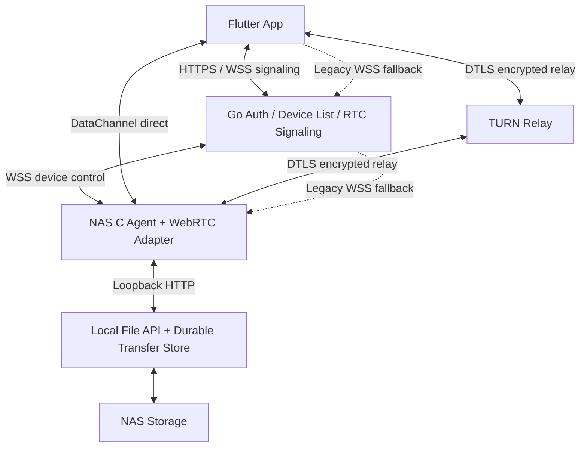
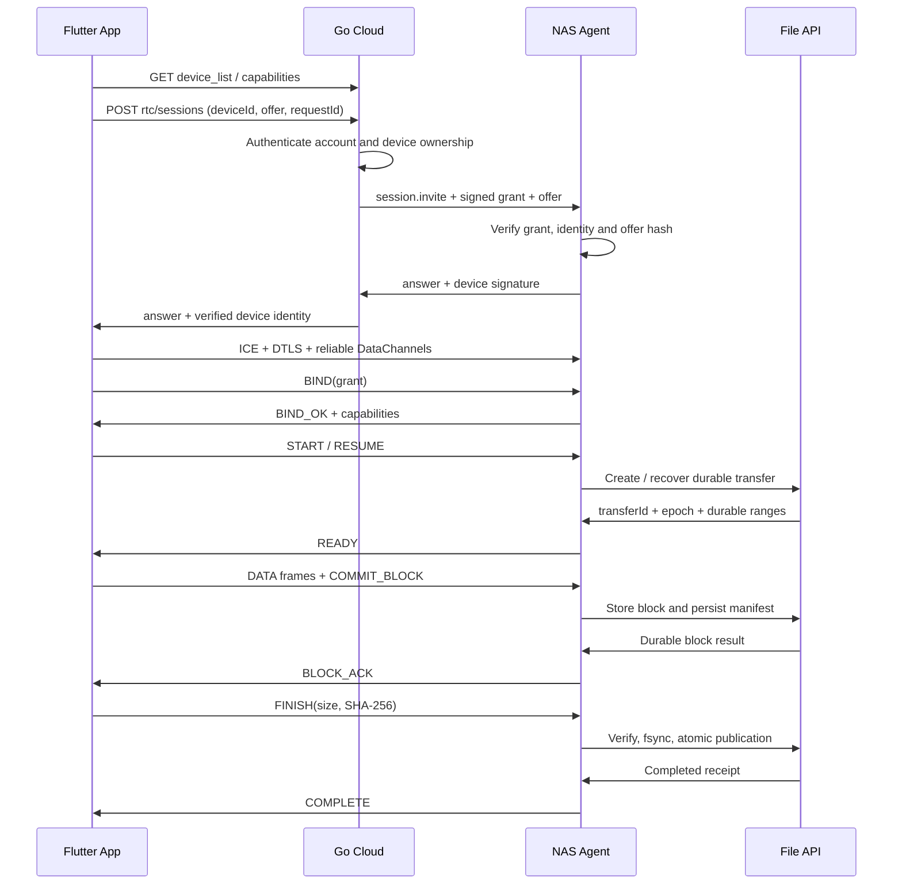

# WebRTC 文件传输设计方案 / WebRTC File Transfer Design

## 中文

### 1. 文档状态、目标与范围

日期：2026-10-20。状态：**待实施的设计方案**，不是已部署功能；本文只新增设计文档，不修改代码、不安装 WebRTC/TURN、不启动 NAS。技术依据已查阅官方标准和项目文档，依赖版本、实际设备性能和互通结果仍需在实施阶段锁定。

目标是在当前 Flutter App、Go 云端和 C NAS 程序上支持图片、视频原文件及其他文件的双向上传下载，优先端到端直连，必要时由 TURN 转发。文件原样传输，不进行媒体转码，不为文件传输创建音视频轨道。DataChannel 支持通用数据和可靠传输，适合文件分片。[RFC 8831](https://www.rfc-editor.org/rfc/rfc8831.html)

首期覆盖前台传输、进度、暂停、取消、进程重启后的断点续传、完整性校验及失败回退。实时视频播放/转码、相册全量自动备份、多设备同时写同一文件、iOS 无限后台传输不在首期范围。大视频作为文件处理，不能由“支持视频文件”推导出“支持实时视频通话”。

### 2. 当前项目基线与差距

| 组件 | 已有能力 | 本方案新增 |
| --- | --- | --- |
| Flutter `mobile/lib/main.dart` | 云端账号、纵向设备列表、目录、相册/文件选择、WS 中继上传下载 | WebRTC 连接、传输适配器、流式文件读写、本地任务持久化 |
| Go `cmd/cloud` | 注册登录、设备绑定、`device_list`、心跳、所有者会话和 WS 中继 | 独立 RTC 信令、会话授权、ICE 配置、TURN 短期凭证、能力协商 |
| C `device/se9-c/se9_agent.c` | UDP 发现绑定、设备私钥/token、心跳、WS 到 File API 转发 | WebRTC DataChannel、会话鉴权、协议解码、限流与传输调度 |
| C `device/se9-c/se9_file_api.c` | 本地文件 API、上传分片、下载/Range、SHA-256 | 持久化传输任务、用户归属、下载快照、幂等提交与断点恢复 |
| 部署 | 阿里云 `123.56.147.51`，Nginx `/se9/` → Go `18082` | HTTPS/WSS 信令入口、STUN/TURN 及其端口和配额 |

当前 Agent 已内置 `https://123.56.147.51:8443` 和 `/se9`；本机 File API 源码默认端口 `8443`，现有指南使用 `18443`。当前 Agent 中继单帧上限 16 MiB；App 默认上传分片 8 MiB，部分路径会整文件读入内存，上传会话索引不跨重启持久化。这些是需要改造的真实限制，不是本方案的 WebRTC 参数。

既有设备长期私钥、设备 ID、绑定关系、账号、存储文件和 UDP 绑定协议继续使用。新增状态与旧 JSON 状态文件分开存放，避免升级时改变既有身份。

### 3. 总体架构与传输选择



云端控制面负责账号、设备归属、会话和信令；文件内容优先不经过 Go。NAS File API 作为唯一存储执行者，Agent 不再另建一套绕过权限和上传状态的文件写入逻辑。

传输选择规则：

1. 能力检查通过后，以 ICE `all` 策略建立 WebRTC；收集直连和 TURN 候选，由 ICE 选择可用路径，不把“先等直连超时再配置 TURN”作为默认实现。
2. 候选对为 host/srflx 等直接路径时，显示“直连”；任一选定候选为 relay 时，显示“TURN 中继”。无法可靠获取候选统计时显示“WebRTC”，不能猜测直连。
3. 25 秒内无法建立可用数据通道，或兼容性校验失败，根据 `allowLegacyRelay` 回退到现有 WSS 中继的**有界分块适配器**。
4. 网络切换时优先一次 ICE restart；仍失败则暂停当前 writer、查询已持久化块并切换通道。传输任务与网络连接分离，不能从零重传完整文件。

ICE/STUN/TURN 用于 NAT 和防火墙穿越；特定网络需要 TURN，不能保证所有连接都是 P2P。[RFC 8835](https://www.rfc-editor.org/rfc/rfc8835.html)

### 4. 技术选型与依赖边界

| 位置 | 候选 | 决策与准入条件 |
| --- | --- | --- |
| Flutter | `flutter_webrtc` | 使用 PeerConnection、二进制 DataChannel；先验证 iOS/Android、buffered amount、消息上限、ICE restart 和候选统计 |
| NAS | `libdatachannel` 的 C API | 业务代码继续 C；库本体是 C++17，因此 CMake/目标镜像需加入 C++ 工具链及匹配运行库；只启用数据通道所需功能 |
| 云端 | 现有 Go 服务新增 signaling 模块 | Go 不必成为 WebRTC 文件端点；复用当前认证但不用现有“每请求一个中继配对”代替长期设备信令 |
| STUN/TURN | coturn | 独立进程，可先同 ECS 部署；后续按带宽扩容，短期凭证按会话签发 |
| 协议 | 项目自定义 `SE9-FT/1` | 明确分帧、存储 ACK、权限、恢复、版本和错误码；不把 HTTP 8 MiB 分片直接当作一次 DataChannel send |

这些候选的通道/API 能力见 [Flutter 官方仓库](https://github.com/flutter-webrtc/flutter-webrtc)、[PeerConnection 文档](https://flutter-webrtc.org/docs/flutter-webrtc/api-docs/rtc-peerconnection/)、[libdatachannel 项目](https://libdatachannel.org/)及其 [C API](https://libdatachannel.org/pages/reference.html)。首个互通里程碑通过后，固定 tag/commit、构建选项、许可证清单和校验值，不在设计文档凭空指定“最新版”。原始消息回调需要复制或转交受控队列，不能跨线程继续使用已经失效的回调缓冲区；所有连接和句柄按所有权关闭、释放。

### 5. 信令流程与云端接口设计

以下路径均为**新增设计**。Go 内部路径不带 `/se9`；公网通过已有 Nginx 路由加 `/se9` 前缀。HTTP 响应复用当前 `code/message/data` 包络。现有 `device_list`、UDP 绑定、旧 `/sessions` 和 relay 接口保持兼容。

| 方法与路径 | 调用方 / 鉴权 | 行为 |
| --- | --- | --- |
| `GET /api/v2/devices` / `device_list` | App 用户 Token | 增加设备 `capabilities.fileTransferTransports`、`fileTransferProtocolVersions`，无字段视为旧设备 |
| `POST /api/v2/rtc/sessions` | App 用户 Token | 校验设备所有权、在线状态、配额和 offer；创建协商并返回 grant、ICE 配置与会话 ID |
| `GET /api/v2/rtc/sessions/{id}` | 原账号 | 查询状态、到期、当前协商代次；不泄露其他账号会话 |
| `POST /api/v2/rtc/sessions/{id}/renew` | 原账号 | 再校验归属，续签短期 grant，必要时更新 TURN 凭证 |
| `DELETE /api/v2/rtc/sessions/{id}` | 原账号 | 幂等关闭连接，保留可恢复文件任务 |
| `GET /api/v2/rtc/signaling/app` | WSS + 用户 Token | 升级前鉴权，按会话转发 answer、candidate、状态 |
| `GET /api/v2/rtc/signaling/device` | WSS + `X-Device-Token` | 设备长期控制连接，接收本设备 invite，区分多个会话 |

创建会话示例：

```json
{
  "deviceId": "254ebf589737390485d71b6e698ff7b6",
  "requestId": "b7223e46d4b44c2d8f0e7a519839d162",
  "purpose": "file-transfer",
  "protocolVersions": [1],
  "offer": {"type": "offer", "sdp": "<application-only SDP>"},
  "allowLegacyRelay": true
}
```
```json
{
  "code": "0",
  "data": {
    "rtcSessionId": "rtc-<random-id>",
    "grant": "<signed-session-grant>",
    "expiresIn": 1800,
    "grantExpiresIn": 300,
    "signalPath": "/api/v2/rtc/signaling/app",
    "iceServers": [
      {"urls": ["stun:123.56.147.51:3478"]},
      {"urls": ["turn:123.56.147.51:3478?transport=udp", "turn:123.56.147.51:3478?transport=tcp"], "username": "<expiry>:<session>:app", "credential": "<temporary-password>"}
    ],
    "capabilities": {"protocolVersion": 1, "maxFrameBytes": 16384, "blockBytes": 1048576}
  }
}
```

示例 `iceServers` 展示现有 IP 上**计划部署**的服务，并不表示 3478 已开放。正式环境信令必须使用可验证的 HTTPS/WSS；TURN TLS 还需增加 `turns:turn.example.com:5349?transport=tcp`，域名只是占位符。



App 为唯一 offer 发起方，先创建 application-only PeerConnection 与两个 DataChannel，再生成 offer。云端校验 offer 限额和归属、创建会话，向已认证设备控制连接投递 invite；返回 201 代表会话被接受，不代表文件通道已连接。控制连接未在线时返回明确的设备不可达错误。

App WSS 连接携带 `rtcSessionId`，但用户 Token 不放 URL；NAS WSS 使用请求头设备 token，失败不能退回无鉴权连接。App 连接前 NAS 已返回的 answer/候选需要短期缓存；重连按最后确认的信令 sequence 重发未确认消息。重复 messageId 幂等，只有当前 negotiationId 的 candidate 生效；未设置 remote description 前候选进入有界队列，end-of-candidates 单独表示。每条信令限制 256 KiB、候选每代最多 128 条、速率限额和超额错误均在云端执行。

```json
{
  "version": 1,
  "type": "ice.candidate",
  "rtcSessionId": "rtc-<random-id>",
  "negotiationId": "neg-<random-id>",
  "messageId": "msg-<random-id>",
  "sequence": 3,
  "payload": {"candidate": "<candidate>", "sdpMid": "0", "sdpMLineIndex": 0}
}
```

会话建立超时建议 25 秒；PeerConnection 会话租约 30 分钟可续期，grant 5 分钟并在到期前 60 秒续签；这些均是待验证的项目建议值。信令/Go 重启后可重建协商，文件任务仍由 NAS 持久状态恢复，不要求恢复旧 DTLS 连接。

### 6. 连接身份、授权与数据安全

DTLS 加密不能替代账号授权。正式信令先使用 HTTPS/WSS，防止用户 Token、SDP 和 ICE 凭证被篡改或窃取；已有 HTTP 联调入口仅用于隔离验证，不能据此宣称端到端身份已安全。

云端使用独立签名私钥签发短期 grant，NAS 通过预置或可信分发的公钥校验；与设备私钥、设备 token、`SE9_AGENT_PROXY_TOKEN`、TURN shared secret 分离。grant 至少包含 `iss/aud/sub/iat/nbf/exp/jti`、`rtcSessionId`、`deviceId`、当前允许操作、协议版本、offer SHA-256、App DTLS SHA-256 fingerprint、允许的传输方式。拒绝错误签发方、受众、过期、其他设备及重放；时钟必须同步。

NAS 先校验 grant 绑定的 offer，再校验通道实际 DTLS 对端 fingerprint 与授权一致，`BIND(grant)` 成功前不接收文件操作。NAS 用原 Ed25519 设备私钥签名 `sessionId + negotiationId + offerHash + answerHash` 的固定规范编码，App 使用已绑定且经认证获取的设备公钥验签，并核对 answer 与实际 DTLS fingerprint。实现前必须验证候选库能够完成该校验，不能只比较来自同一未验证消息的两个字符串。

WebSocket 回退时继续校验云端会话所有权和同一 grant；Agent 只信任已验证云端 WSS 连接中的原账号上下文，校验 `sub/deviceId/sessionId/allowedTransports` 后再授权请求。不能把 RTC fingerprint 检查静默省略后接受任意来源的 HTTP 请求。授权主体由 Agent 生成并传给受信任的回环 File API，客户端提供的 `X-Agent-Proxy-Token`、用户 ID 或 owner 字段全部剔除，不能据此获得权限。

回退接入协议也需要实施：新客户端创建旧中继会话时附带 `rtcSessionId`，Go 验证两个会话的用户和设备一致，并向支持新能力的 Agent 首先发送带云端签名的 `relay.attach` 上下文（relaySessionId、rtcSessionId、userId、deviceId、grantId、到期时间）。Agent 验证并确认后才接受该连接的分块 HTTP 请求。旧客户端/旧 NAS 不启用该前导帧，沿用原协议；不能未经协商就在所有旧连接中插入 JSON。该上下文、同一任务 grant 和连接代次共同限定回退请求，不信任客户端自报用户。

文件任务绑定 `userId + deviceId + transferId`。断点恢复需要新有效会话/grant及恢复凭证，单独知道 transferId 不允许读写。暂停/取消/下载同样检查归属；首期仅允许 owner，不虚构已有成员权限体系。云端控制断开时已有任务最多运行到 grant 到期，然后暂停；移除归属/撤销时发送 revoke，仍以短期租约限制无法即时通知的离线端。

WebRTC 直连和 TURN 路径中，DataChannel 内容在端点间加密，TURN 只转发密文；旧 WSS 回退在 Go 终止连接，Go 可见转发的文件数据，不具备同样的端到端保密性质。若任务要求严格端到端保密，设置 `allowLegacyRelay=false`，WebRTC 失败后暂停，不能无提示降级。日志不记录 Token、SDP 全文、TURN 密码或文件内容。

### 7. DataChannel 与文件协议 `SE9-FT/1`

App 建立两个使用 DCEP 协商的通道：`se9.control.v1`（UTF-8 JSON 控制）和 `se9.file.v1`（二进制数据）；两者都配置 ordered、可靠传输，`maxRetransmits` 与 `maxPacketLifeTime` 不设置。分开通道可以简化控制调度，但仍共享 SCTP/链路拥塞，不能保证控制消息完全不受文件流量影响。

消息大小受端点协商与实现限制，发送队列也需要背压，见 [W3C WebRTC](https://www.w3.org/TR/webrtc/)。项目初始**整帧**上限 16 KiB，最终取本地/远端能力、原生协商消息上限与该项目上限的最小值；不能把协商值 `0` 误判为可发送零字节，须按原生 API 语义归一化。若 Flutter 未暴露真实上限，先验证保守 16 KiB 在目标组合可用，并在 HELLO 中公布上限；小于协议头长度时拒绝连接。

控制消息统一含 `version/type/requestId/rtcSessionId`，任务建立后含 `transferId/epoch`。类型包括 `HELLO`、`BIND`、`BIND_OK`、`START`、`READY`、`COMMIT_BLOCK`、`BLOCK_ACK`、`STATUS`、`RESUME`、`PAUSE`、`CANCEL`、`FINISH`、`COMPLETE`、`ERROR`。requestId 幂等窗口与结果缓存持久化；`START` 重试返回同一任务，不能新建重复上传。

```json
{
  "version": 1,
  "type": "START",
  "requestId": "req-<random-id>",
  "rtcSessionId": "rtc-<random-id>",
  "payload": {
    "direction": "upload",
    "path": "photos/IMG_001.png",
    "size": "7340032",
    "sha256": "<64-lowercase-hex>",
    "blockBytes": 1048576,
    "overwrite": false
  }
}
```
```json
{
  "version": 1,
  "type": "BLOCK_ACK",
  "requestId": "req-<random-id>",
  "transferId": "cc348558985a4f448d68497f1c2dc08a",
  "epoch": 2,
  "payload": {
    "committedRanges": [{"firstBlock": "0", "lastBlock": "3"}],
    "durableBytes": "4194304",
    "maxInFlightBytes": "2097152"
  }
}
```

控制 JSON 不超过协商的整帧上限；v1 每条状态消息最多返回 64 个块区间，超过时通过 `cursor` 分页，不能为大文件发送无限长位图。关键消息的最小字段如下，响应均关联原 requestId，错误包含稳定错误码及是否可重试：

| 消息 | 必需字段 / 结果 |
| --- | --- |
| `HELLO` | 协议版本、maxFrameBytes、blockBytes、支持传输；协商结果不可越过原生上限 |
| `BIND` / `BIND_OK` | 当前 grant；服务端返回已授权会话、操作与有效期，不返回长期凭证 |
| `START` / `READY` | START 为方向、相对路径、大小及上传完整哈希；READY 为 transferId、epoch、块大小、size、sourceVersion、下载完整哈希、恢复凭证和初始 credit |
| `COMMIT_BLOCK` | transferId、epoch、blockIndex（十进制字符串）、length（十进制字符串）、SHA-256；下载和上传方向均由发送方提交 |
| `STATUS` / `RESUME` | transferId、恢复凭证、当前用户授权，下载还含 sourceVersion；返回持久块区间及 cursor，RESUME 分配新 epoch |
| `FINISH` / `COMPLETE` | FINISH 为 size、完整 SHA-256；COMPLETE 为持久完成回执、最终路径/版本、size 和 SHA-256 |
| `PAUSE` / `CANCEL` | transferId、epoch 和幂等 requestId；返回已确认的最终任务状态 |

大小、偏移、块号、累计字节等可能超过 JavaScript 安全整数范围的 JSON 字段统一使用十进制字符串；epoch 为 uint32，不能溢出回绕。transferId 为 16 字节随机 ID，在 JSON 中表示为 32 位十六进制。逻辑块默认 1 MiB，与 DataChannel 16 KiB 帧及旧上传 8 MiB 分片区分；任务创建后块大小不可改变。

二进制帧头固定 **48 字节**，整数使用网络字节序：

| 偏移 | 长度 | 字段 / 校验 |
| --- | --- | --- |
| 0 | 4 | ASCII `S9FT` |
| 4 | 1 | version = 1 |
| 5 | 1 | frameType = 1（DATA） |
| 6 | 2 | flags，v1 必须为 0 |
| 8 | 16 | transferId 原始字节 |
| 24 | 4 | epoch，拒绝旧 writer |
| 28 | 4 | sequence，本 epoch 内单调递增，回绕前重建 epoch |
| 32 | 8 | 文件绝对 offset，uint64 |
| 40 | 4 | payloadLength，等于消息总长减 48 |
| 44 | 4 | reserved，必须为 0 |
| 48 | N | 文件字节，N ≤ maxFrameBytes − 48 |

每帧不得跨逻辑块边界，不得越过声明文件大小，必须属于有效任务、方向和 epoch。接收方验证长度溢出、重复和位置；不完整块断线后按块重传。逻辑块完整后校验 SHA-256，整文件完成时再校验 SHA-256，不使用 `send()` 成功或 SCTP 收包回调代替存储确认。

控制和数据通道没有跨通道顺序保证：`COMMIT_BLOCK` 或 `FINISH` 先到时，接收方等待已声明数据到齐，在有界超时后报告缺失；不能立即误报完成或丢弃尚在途的数据。上传 START 提供文件完整哈希；大文件预计算时 UI 显示“准备中”，内存保持有界。零字节文件不发送 DATA，按空文件 SHA-256 完成。

### 8. NAS 持久化传输与本机 API

不直接扩展当前内存 `uploads[]` 为唯一权威状态。File API 新增独立任务存储层，提供给 Agent 的 RTC 与旧 WS 两个适配器，所有接口在本机鉴权后使用 grant 派生的用户上下文。

| 新本机接口 | 用途 |
| --- | --- |
| `POST /api/v2/transfers` | upload/download 初始化，校验路径、空间、权限、幂等键；返回 transferId、恢复凭证、块大小和有效期 |
| `GET /api/v2/transfers/{id}` | 任务状态、已持久化块区间、sourceVersion、epoch |
| `PUT /api/v2/transfers/{id}/blocks/{index}` | 存储一个不超过 1 MiB 的上传逻辑块及其哈希 |
| `GET /api/v2/transfers/{id}/blocks/{index}` | 从固定下载快照读取一个逻辑块及哈希 |
| `POST /api/v2/transfers/{id}/resume` | 校验主体和恢复凭证，取得新 writer epoch/租约，废止旧连接 |
| `POST /api/v2/transfers/{id}/complete` | 完整性检查和最终原子发布/完成回执 |
| `DELETE /api/v2/transfers/{id}` | 幂等取消并按策略清理临时文件 |

这些是新增接口，不是现有 API；仅添加方案不代表当前 File API 支持。恢复凭证为随机 256 位值，服务端只存哈希；App 放入系统安全存储，不能按路径公开查询。

任务目录建议为 `STORAGE_ROOT/.se9-transfers/<transferId>/`，保存 manifest、块文件及恢复信息；不能通过普通文件列表/下载读取该内部目录。manifest 含用户/设备/方向/路径/大小/完整哈希/块大小/逐块哈希/持久区间/epoch/状态/TTL/下载快照标识。恢复凭证保留哈希；客户端持有原值。manifest 采用临时文件、fsync、rename、父目录 fsync；所有状态更新有每任务互斥锁和跨进程文件锁。

上传 ACK 顺序：写块临时文件 → 校验哈希 → fsync → 同目录 rename/目录 fsync → 原子更新并同步 manifest → 返回 BLOCK_ACK。断电后只承认可恢复的已落盘块；孤立临时块重算/清理，不把其计入进度。同块同哈希重试返回成功，不同哈希返回冲突。完成时逐块合并到目标同一文件系统临时文件，流式校验完整哈希，fsync 后以**不覆盖已存在文件**的原子语义发布，再持久化完成回执。跨“发布成功但 manifest 未完成”的崩溃窗口需有提交意图记录和启动校对，不得覆盖已有文件来恢复。

路径通过 storage root dirfd、逐级 `openat`/`O_NOFOLLOW` 或同等安全机制解析，拒绝绝对路径、`..`、符号链接逃逸、保留目录和非法名称；不能仅依赖字符串前缀判断。首期 `overwrite=false`，重名明确失败，用户另选名称；自定义覆盖模式后续另行设计。

下载任务建立不可变源快照：文件系统支持时使用 reflink，否则复制到任务目录并检查磁盘配额。复制前后核对源 inode、size、纳秒级 mtime/ctime，变化则丢弃副本并有界重试，持续变动时返回 SOURCE_CHANGED；需要严格某一时刻快照但文件系统不支持时，必须与所有写入方协作加锁，否则拒绝该模式，不宣称普通复制具有原子快照语义。快照完成后计算 size、SHA-256 和 sourceVersion（快照 ID 与内容哈希），再发送 READY；打开原文件 fd 只能稳定 inode，不能防止其他进程原地改写，因此不作为快照的替代。快照/未完成上传 TTL 建议 24 小时；任务占用磁盘计入配额，上传预留块文件与最终合并所需空间，下载预留快照空间。

### 9. 上传、下载、恢复与取消

**上传**：App 将相册临时资源导入持久任务缓存并取得稳定文件句柄 → 流式计算完整哈希 → START → NAS 分配任务 → App 按接收窗口发送帧并提交逻辑块 → NAS durable ACK → FINISH → NAS 合并、校验、发布 → COMPLETE → App 刷新当前设备目录。上传进度采用 NAS 确认的 durableBytes，100% 数据发送后仍显示“校验中”，只有 COMPLETE 才提示成功。

**下载**：App START(download, path) → NAS 创建快照并返回文件元数据 → App 创建可随机访问的本地临时文件和持久任务 → NAS 按块读取和发送 → App 写入、校验、同步本地任务后 ACK → 完整哈希一致后标记下载完成 → 用户导出到系统文件位置。不能沿用当前 `remoteDownload()` 整文件收集或 `FilePicker.saveFile(bytes: 全文件)` 作为大文件实现；导出需要原生文件 URL/流接口适配，iOS 文档目录和 Android SAF 在 PoC 阶段验证。取消导出不表示 NAS 下载失败，缓存按保留策略处理。

**恢复**：重新登录并取得新会话/grant → RESUME(transferId, resumeToken, sourceVersion) → 服务端按相同主体验证，增加持久 epoch → 交换已持久化块区间 → 只补缺失块。上传以 NAS manifest 为准；下载以 App 的持久位图为准，NAS 校验范围和快照版本。重连/切换 transport 不改变 transferId；丢失本地持久缓存、恢复凭证或快照过期时明确提示重新建任务。禁止旧连接与新连接同时写。

**暂停/取消**：暂停停止新发送并保留持久块，未确认块下次重传；取消发送带 requestId 的 CANCEL 并记录终态。对端离线时本地先标记 cancel-pending，重连后补发，不能声称已清理 NAS。cancel 与 complete 由任务锁串行化，返回最终胜出的状态。FINISH/COMPLETE 丢失时先 STATUS，不能再次发布或另建重复文件。

应用进入后台首期执行可恢复暂停；前台/重启后继续。不能承诺 iOS 会长期维持普通 DataChannel 进程。相册原始临时路径、用户授权和系统文件句柄需要生命周期管理，不能只保存文件名就宣称支持恢复。

### 10. 背压、资源预算和回退一致性

| 参数 | 首期建议值，需实测 |
| --- | --- |
| maxFrameBytes | 16 KiB，含 48 字节头，最终服从协商上限 |
| blockBytes | 1 MiB，一经建任务固定 |
| 发送队列高/低水位 | 1 MiB / 256 KiB |
| 接收方未持久数据窗口 | 每任务最多 2 MiB |
| 单设备并发活跃文件任务 | 2；初期 UI 每次一个，其他排队 |
| 信令建立 / 无进度超时 | 25 秒 / 30 秒；超时先 STATUS/恢复，不盲目新建文件 |
| 任务/快照保留 | 24 小时；配额允许时可配置 |
| 会话/grant/TURN 凭证 | 30 分钟可续 / 5 分钟可续 / 初始 60 分钟，长任务刷新策略需互通验证 |

发送同时满足本地队列阈值和接收方 credit；BLOCK_ACK 释放未持久字节窗口。队列低水位回调恢复发送，Flutter 若缺少回调使用有界的短周期查询，不能忙等。ACK 只累计确认真实落盘数据；额外应用层 ACK 用于持久性、恢复和磁盘背压，不另写一套与 SCTP 抢重传的包级可靠协议。

NAS Agent 每个活跃任务只缓冲有限帧/逻辑块，磁盘 I/O 在工作线程处理，不阻塞 WebRTC 回调线程。hash、合并和快照生成流式进行。总内存预算包含 SDK/SCTP/native 缓冲和跨 Dart/native 拷贝，不能仅凭 2 MiB 应用窗口承诺总 RSS。TURN 转发仍消耗 ECS 带宽，直连不保证比 HTTP 更快。

回退必须复用新 `transfer_store` 和 1 MiB 本机接口，WS 每次只承载一个有界块及小型控制报文，低于现有 Agent 的 16 MiB 限制。不得直接调用旧整文件下载函数来声称大文件回退已完成。切换前 fencing 旧 epoch，恢复凭证和块索引保持一致，校验完成后才显示成功。

### 11. 状态机、错误与可观测性

连接状态：`IDLE → AUTHORIZING → SIGNALING → ICE_CONNECTING → BINDING → READY`；故障进入 `RECOVERING → READY / LEGACY_RELAY / PAUSED / FAILED`。传输状态独立：`CREATED → PREPARING → TRANSFERRING → VERIFYING → COMPLETED`，可进入 `PAUSED / CANCEL_PENDING / CANCELLED / EXPIRED / FAILED`。连接断开不把文件任务直接变成永久失败。

| 设计错误码 | 行为 |
| --- | --- |
| `RTC_UNSUPPORTED` / `PROTOCOL_MISMATCH` | 按策略使用旧适配器或提示升级，不无限重试 |
| `RTC_AUTH_FAILED` / `GRANT_EXPIRED` | 暂停，重新登录或续签，不能降级绕过鉴权 |
| `ICE_FAILED` / `CHANNEL_CLOSED` | 有界 ICE restart，再恢复/切换 |
| `SOURCE_CHANGED` / `SNAPSHOT_EXPIRED` | 拒绝拼接新旧版本，重新创建下载任务 |
| `HASH_MISMATCH` / `BLOCK_CONFLICT` | 定位块重传或失败；从不发布损坏文件 |
| `STALE_EPOCH` | 关闭旧 writer，查询当前任务 |
| `NO_SPACE` / `QUOTA_EXCEEDED` | 暂停并释放 credit，不继续堆积内存 |
| `PATH_DENIED` / `OWNERSHIP_CHANGED` | 拒绝操作，按授权策略清理连接 |

记录 sessionId/transferId/requestId、协商代次、路径类型、ICE耗时、失败阶段、发送/持久字节、块重试、恢复次数、速度、校验时长、内存及 TURN 字节；IP 和文件路径按权限控制留存。UI 保留纵向设备列表，设备卡片显示在线状态；任务显示直连/TURN/服务器转发、准备/传输/校验阶段、进度、速度、暂停和取消，不向用户展示 SDP 或实现错误堆栈。

### 12. 代码改造清单

以下文件名为计划拆分，不表示已创建：

| 模块 | 计划文件 / 改动 |
| --- | --- |
| Flutter 会话与信令 | `mobile/lib/transfer/rtc_session.dart`、`rtc_signaling.dart`；现有 API 类增加能力和会话接口 |
| Flutter 协议与传输 | `ft_protocol.dart`、`rtc_transport.dart`、`legacy_transport.dart`；统一 `TransferTransport` 接口 |
| Flutter 文件与任务 | `transfer_repository.dart`、`file_io.dart`；任务元数据和缓存、安全保存恢复凭证、原生流式导出 |
| Flutter 首页 | `main.dart` 逐步拆分页面，设备上传下载进入统一任务管理；纵向设备列表保持 |
| Go | `cmd/cloud/rtc_sessions.go`、`rtc_signaling.go`、`turn_credentials.go`、`session_grant.go`；鉴权、授权、限额及租约 |
| Agent | `rtc_transport.c/.h`、`rtc_signaling.c/.h`、`ft_protocol.c/.h`、`transfer_bridge.c/.h`；保留 C 调用库的 C API |
| File API | `transfer_store.c/.h`、`transfer_routes.c/.h`；持久化、锁、路径边界、快照、哈希和原子发布 |
| CMake/发布 | 加入 C++17 依赖构建、固定库版本、目标 ARM64/x86_64 与 OpenSSL/运行库验证；File API 可保持独立 C 目标 |

协议层必须可脱离网络进行编解码测试。RTC 和 legacy adapter 都经过同一权限/存储层，避免同一任务因通道不同采用两套规则。

### 13. 阿里云与 NAS 部署设计

当前服务器沿用 `123.56.147.51`、`se9-cloud.service`、Go `18082`、Nginx `/se9/` 反向代理。现有状态文件和服务配置继续保留。以下是**拟新增**项目，不是当前已部署事实：

| 配置/端口 | 设计用途 |
| --- | --- |
| HTTPS TCP 443 | 认证 API 与 WSS 信令；配置验证通过的证书和实际域名/IP证书，不以关闭验证代替 |
| UDP/TCP 3478 | STUN/TURN 入口；TCP 到 TURN 是否可用须验证双方库 |
| TCP 5349 | TURN over TLS；不能由普通 HTTP Nginx location 代理 |
| UDP 49160–49259 | 示例 TURN relay 范围，安全组和主机防火墙均需开放；按容量测算扩展 |
| NAS UDP 动态候选端口 | ICE 数据路径，非既有 UDP 37020 发现端口；可在库支持时限制到规划范围 |
| Go 新参数 | `RTC_ENABLED`、`RTC_GRANT_KEY_FILE`、`RTC_SESSION_TTL`、`TURN_URLS`、`TURN_SHARED_SECRET_FILE`、`TURN_CREDENTIAL_TTL` |
| NAS 新参数 | `SE9_RTC_ENABLED`、`SE9_CLOUD_GRANT_PUBLIC_KEY`、任务配额/TTL、候选端口范围；实现后再加入真实参数表 |

coturn 配置草案如下，必须替换占位值并检查所选发行版支持的参数；`turn.example.com` 未配置到当前服务器。ECS 若有公网/私网映射，应填实际对应地址；共享认证密钥仅放在 Go/coturn 服务端，客户端收到短期用户名/密码。项目官方提供了这些配置项的说明。[coturn 配置示例](https://github.com/coturn/coturn/blob/master/examples/etc/turnserver.conf)

```ini
listening-port=3478
tls-listening-port=5349
fingerprint
use-auth-secret
static-auth-secret=<server-only-random-secret>
realm=turn.example.com
external-ip=123.56.147.51/<ecs-private-ip>
min-port=49160
max-port=49259
cert=/etc/letsencrypt/live/turn.example.com/fullchain.pem
pkey=/etc/letsencrypt/live/turn.example.com/privkey.pem
no-multicast-peers
no-cli
```

Go 为 App 与 NAS 分别签发短期 TURN 凭证，用户名包含有效期、会话和角色；认证计算与选定 coturn 的 secret 模式一致，密钥不写入 App/NAS 二进制或公开配置。配额、速率、允许用途及禁止中继到不允许的内部目标按部署环境设置。TURN 凭证更新不保证所有 SDK 已建立 allocation 能无缝延续；首期要求验证长传输，在必要时更新凭证并 ICE restart，再按块恢复。

发布顺序：备份 → 部署 HTTPS 和 TURN、单独验收 → 更新 Go 信令但保持 feature flag 关闭 → 更新 NAS 库与协议模块 → 更新 App → 小范围开启 → 验收后逐步放量。保留当前内置 IP/80 配置用于既有兼容流程；正式启用 RTC 需提供受信任的 HTTPS/WSS 地址，不能将旧 HTTP 凭证交换直接当正式方案。新任务目录加入 systemd `ReadWritePaths`；库不需要文件写入权限时保持原最小权限。备份不覆盖原设备私钥、token、账号或存储文件。

### 14. 验收测试与完成标准

| 类别 | 必须验证的场景 |
| --- | --- |
| 平台互通 | Flutter iPhone/Android ↔ Linux ARM64 NAS；需要的 x86_64；纯 DataChannel 不请求无关的相机/麦克风权限，依赖默认权限行为须实测 |
| 数据正确 | 0 B、1 B、普通照片、各分块边界前后、超过16 MiB视频、1/10 GiB文件；上传下载完整 SHA-256 一致 |
| 网络 | 同 LAN、跨家庭宽带、蜂窝、双 NAT、强制 relay、UDP 禁用但 TURN TCP/TLS 可用、IPv4/IPv6组合 |
| 恢复 | Wi-Fi/蜂窝切换、kill App、kill Agent、File API 重启、Go 重启、NAS 重启及模拟掉电；只恢复真实持久块 |
| 一致性 | ACK/FINISH/COMPLETE 丢失、重复 START、控制先于数据、旧 epoch 帧、两个通道/进程竞争、取消与完成并发 |
| 权限 | 未登录、其他账号/设备、伪造grant、过期、错误fingerprint、被撤销归属、猜测transferId、恢复凭证丢失 |
| 文件系统 | 满盘、配额、只读卷、符号链接路径、重名、源被改写、快照失败、清理期间断电 |
| 边界与资源 | 原生消息上限、malformed frame/长度溢出、超过2^32字节文件、队列背压、RSS、CPU、磁盘 I/O 和长任务凭证续期 |
| 回退 | 新 App/旧 NAS、旧 App/新 NAS、TURN不可用、完整分块 WSS 回退、禁用旧回退的任务、回退后哈希不变 |

建议试点门槛：可控测试网络中声明支持的用例全部通过；传输失败可恢复且不误报成功；传输数据时 RSS 不随文件大小持续线性增长；10 GiB 长任务校验通过，足够磁盘预留另行确认。吞吐不在未实测前承诺，记录直连/TURN/旧中继的 p50/p95、CPU和内存，再决定是否扩大并发或帧大小。

### 15. 实施里程碑、发布和回滚

1. **互通 PoC**：固定库版本，在 iOS/Android 与目标 NAS 上完成两个通道、binary、maxMessageSize、buffered amount、fingerprint、直连与强制 TURN 测试；不接用户存储。
2. **信令与授权**：新增 Go 接口、长期设备连接、grant签名/验证、能力和feature flag；测试过期、归属及重放。
3. **持久存储协议**：实现 transfer_store、快照、单任务串行写、durable ACK 和崩溃恢复；独立验证文件系统安全。
4. **App 上传下载**：流式I/O、持久任务、安全恢复凭证、进度和导出；覆盖图片、视频原文件和空文件。
5. **跨网恢复与回退**：TURN TCP/TLS、凭证续期、ICE restart、fencing、同任务 WSS 分块适配器；后台暂停/恢复。
6. **灰度发布**：跑第14节矩阵，旧版本兼容，监控带宽/成本和资源，再默认启用。所有阶段完成前不对外宣称支持可靠大文件传输。

回滚关闭 RTC feature flag，新会话走已验收的旧中继或暂停；正在传输任务先持久化/暂停，不并行双写。保留新任务数据至 TTL，旧程序不解析新目录、不删除它；不回滚云端账号/设备JSON，不更换设备私钥。需要旧程序继续新任务时，必须已有兼容的 transfer_store/legacy adapter，否则提示升级后恢复，不承诺降级可读新任务。

### 16. 实施前待确认事项

- 实体 NAS 的 CPU架构、内存、可用磁盘、文件系统是否支持 reflink、目标并发和最大文件大小。
- HTTPS 域名或IP证书、TURN证书、ECS私网映射、带宽费用和可开放端口；本文未假定这些已配置。
- Flutter 与 NAS库固定版本，原生接口是否暴露消息上限、fingerprint、候选统计和重启ICE；C++依赖与许可证是否符合发行要求。
- iOS/Android稳定文件导入、系统安全存储和大文件流式导出方案；后台暂停是否满足产品需求。
- 回退是否允许 Go 看到文件内容；要求端到端保密的任务必须禁用旧 WSS 回退。

这些是实施入口的环境与产品约束，不影响本文给出默认设计，但未验证前不能把示例配置当作已上线能力。

### 17. 依据与相关文档

以上帧格式、参数、路径和接口是本项目设计决策；标准只作为机制依据，不代表它们定义了 `SE9-FT/1` 或已保证项目性能。查阅日期：2026-10-20。

- [RFC 8831: WebRTC Data Channels](https://www.rfc-editor.org/rfc/rfc8831.html)
- [RFC 8835: Transports for WebRTC](https://www.rfc-editor.org/rfc/rfc8835.html)
- [W3C WebRTC specification](https://www.w3.org/TR/webrtc/)
- [Flutter WebRTC official repository](https://github.com/flutter-webrtc/flutter-webrtc)
- [Flutter WebRTC PeerConnection API](https://flutter-webrtc.org/docs/flutter-webrtc/api-docs/rtc-peerconnection/)
- [libdatachannel project](https://libdatachannel.org/)
- [libdatachannel C API](https://libdatachannel.org/pages/reference.html)
- [coturn official configuration example](https://github.com/coturn/coturn/blob/master/examples/etc/turnserver.conf)

项目依据：[NAS部署与运维](device/se9-c/README.md)、[API文档](SE9_API.md)、[云端说明](cmd/cloud/README.md)、[总体设计](PROJECT_DESIGN.md)。

## English

### 1. Document status, goals, and scope

Date: 2026-10-20. Status: **design proposal awaiting implementation**, not deployed functionality. This change only adds documentation; it does not modify code, install WebRTC/TURN, or start the NAS. Official standards/project documentation were checked; dependency versions, physical-device performance, and interoperability still need implementation-stage validation.

Enable bidirectional uploads/downloads of images, original video files, and other files between the current Flutter App and C NAS, preferring direct connections with TURN when needed. Preserve file bytes without transcoding or media tracks. DataChannels provide generic data and reliable delivery suitable for file fragments. [RFC 8831](https://www.rfc-editor.org/rfc/rfc8831.html)

Phase one covers foreground transfers, progress, pause/cancel, resume across process restarts, integrity checks, and failure fallback. Live video/transcoding, full automatic gallery backup, simultaneous writers to the same file, and unlimited iOS background execution are excluded. Video-file support does not imply real-time video calling.

### 2. Existing project and gaps

| Component | Implemented | Proposed additions |
| --- | --- | --- |
| Flutter `mobile/lib/main.dart` | Accounts, vertical device list, directories, gallery/file selection, WS transfers | WebRTC, transport adapters, streaming file I/O, persistent local tasks |
| Go `cmd/cloud` | Authentication, binding, `device_list`, heartbeats, owner sessions and WS relay | Dedicated RTC signaling, grants, ICE configuration, temporary TURN credentials, capabilities |
| C `device/se9-c/se9_agent.c` | UDP discovery/claiming, device identity/token, heartbeat, WS-to-File API forwarding | DataChannels, session authorization, framing, flow control and scheduling |
| C `device/se9-c/se9_file_api.c` | Local API, upload chunks, download/Range, SHA-256 | Persistent transfers, principal ownership, download snapshots, idempotent commits/resume |
| Deployment | Cloud `123.56.147.51`, Nginx `/se9/` → Go `18082` | HTTPS/WSS signaling, STUN/TURN, ports and quotas |

Agent currently embeds `https://123.56.147.51:8443` and `/se9`. File API defaults to `8443`; the deployment guide uses `18443`. Existing relay frames are limited to 16 MiB, App upload chunks default to 8 MiB, some paths load entire files into memory, and upload indexes do not persist across restarts. These are current limitations to change, not proposed WebRTC settings.

Keep existing long-lived device keys, IDs, binding, accounts, stored files, and UDP claiming. Store new task state separately from existing cloud JSON so upgrades preserve identities.

### 3. Architecture and transport selection


The cloud control plane manages accounts, ownership, sessions, and signaling; file bytes preferably bypass Go. File API remains the single storage authority. Agent must not add independent file-writing rules that bypass permissions or upload state.

Selection policy:

1. After capability checks, establish WebRTC with ICE policy `all`, gathering direct and TURN candidates together. Let ICE select a viable path rather than waiting for a direct-only timeout before enabling TURN.
2. Show direct when the selected pair uses direct candidates, TURN relay when either selected candidate is relay. If reliable statistics are unavailable, display WebRTC without guessing.
3. If no usable channel opens within 25 seconds, or compatibility fails, use the existing WSS relay through a **bounded block adapter**, subject to `allowLegacyRelay`.
4. On network change attempt one ICE restart, then pause/fence the current writer, query committed blocks, and switch transport. File tasks outlive connections; do not resend the entire file from zero.

ICE/STUN/TURN handle NAT/firewall traversal; some networks require TURN, so P2P is not guaranteed. [RFC 8835](https://www.rfc-editor.org/rfc/rfc8835.html)

### 4. Technology choices and dependency boundaries

| Location | Candidate | Decision and admission checks |
| --- | --- | --- |
| Flutter | `flutter_webrtc` | PeerConnection and binary channels; verify iOS/Android, buffered amount, message limits, ICE restart, candidate statistics |
| NAS | `libdatachannel` C API | Keep application code in C; library uses C++17, requiring a matching C++ toolchain/runtime and target builds; enable only required data features |
| Cloud | Signaling modules in existing Go service | Go need not be a WebRTC file endpoint; existing per-request relay matching is not a persistent device signaling connection |
| STUN/TURN | coturn | Separate process, initially possibly on the same ECS; scale bandwidth independently; issue per-session temporary credentials |
| Protocol | Project-specific `SE9-FT/1` | Specify framing, durable ACKs, authorization, resume, versioning, errors; never send an existing 8 MiB HTTP chunk as one DataChannel message |

See the [Flutter repository](https://github.com/flutter-webrtc/flutter-webrtc), [PeerConnection documentation](https://flutter-webrtc.org/docs/flutter-webrtc/api-docs/rtc-peerconnection/), [libdatachannel project](https://libdatachannel.org/), and [C API](https://libdatachannel.org/pages/reference.html). After interoperability passes, pin tags/commits, build options, license inventory, and checksums. Do not invent a latest-version guarantee here. Copy callback payloads or transfer ownership into bounded queues; never retain invalid native callback buffers. Close/free connections and handles according to explicit ownership.

### 5. Signaling flow and cloud APIs

All following RTC paths are **proposed additions**. Internal Go paths omit `/se9`; public routes use the existing Nginx prefix. Responses retain the current `code/message/data` envelope. Existing device lists, UDP claiming, `/sessions`, and relay interfaces remain compatible.

| Method and path | Caller/authentication | Behavior |
| --- | --- | --- |
| `GET /api/v2/devices` / `device_list` | App user token | Add `capabilities.fileTransferTransports` and `fileTransferProtocolVersions`; missing fields mean legacy device |
| `POST /api/v2/rtc/sessions` | App user token | Validate owner, availability, quotas, offer; return negotiation ID, grant, ICE configuration |
| `GET /api/v2/rtc/sessions/{id}` | Original account | Session state, expiry, current negotiation; no other-account disclosure |
| `POST /api/v2/rtc/sessions/{id}/renew` | Original account | Recheck ownership and renew grant/TURN credentials as needed |
| `DELETE /api/v2/rtc/sessions/{id}` | Original account | Idempotently close connection while preserving resumable tasks |
| `GET /api/v2/rtc/signaling/app` | WSS + user token | Authenticate before upgrade; relay session answers, candidates, status |
| `GET /api/v2/rtc/signaling/device` | WSS + device token header | Persistent authenticated device control connection, multiple explicit sessions |

Session examples:

```json
{
  "deviceId": "254ebf589737390485d71b6e698ff7b6",
  "requestId": "b7223e46d4b44c2d8f0e7a519839d162",
  "purpose": "file-transfer",
  "protocolVersions": [1],
  "offer": {"type": "offer", "sdp": "<application-only SDP>"},
  "allowLegacyRelay": true
}
```
```json
{
  "code": "0",
  "data": {
    "rtcSessionId": "rtc-<random-id>",
    "grant": "<signed-session-grant>",
    "expiresIn": 1800,
    "grantExpiresIn": 300,
    "signalPath": "/api/v2/rtc/signaling/app",
    "iceServers": [
      {"urls": ["stun:123.56.147.51:3478"]},
      {"urls": ["turn:123.56.147.51:3478?transport=udp", "turn:123.56.147.51:3478?transport=tcp"], "username": "<expiry>:<session>:app", "credential": "<temporary-password>"}
    ],
    "capabilities": {"protocolVersion": 1, "maxFrameBytes": 16384, "blockBytes": 1048576}
  }
}
```

Example ICE URLs describe **planned**, not deployed, services on the current IP. Production signaling requires verified HTTPS/WSS. TURN TLS additionally uses `turns:turn.example.com:5349?transport=tcp`; this domain is a placeholder.


App is the only offerer. Create an application-only PeerConnection and two channels before generating the offer. Cloud checks limits/ownership, creates the session, and invites the authenticated device. HTTP 201 means accepted, not a ready file channel. Return device-unreachable when its control connection is unavailable.

App WSS identifies `rtcSessionId` without putting tokens in URLs; NAS WSS uses its device-token header and never retries unauthenticated. Buffer early answers/candidates until App signaling attaches. Reconnect using the last acknowledged signaling sequence. Deduplicate messageId, apply only current negotiationId candidates, queue candidates until remote description exists, and represent end-of-candidates separately. Bound messages to 256 KiB and 128 candidates per negotiation, with cloud rate limits and explicit errors.

```json
{
  "version": 1,
  "type": "ice.candidate",
  "rtcSessionId": "rtc-<random-id>",
  "negotiationId": "neg-<random-id>",
  "messageId": "msg-<random-id>",
  "sequence": 3,
  "payload": {"candidate": "<candidate>", "sdpMid": "0", "sdpMLineIndex": 0}
}
```

Suggested establishment timeout is 25 seconds. Connection lease is renewable for 30 minutes; grants last five minutes and renew 60 seconds before expiry. These are project tuning values. After signaling/Go restart, renegotiate and recover files from NAS durable state rather than restoring old DTLS connections.

### 6. Peer identity, authorization, and data security

DTLS encryption does not replace account authorization. Use HTTPS/WSS for production signaling to protect user tokens, SDP, and ICE credentials. Existing HTTP integration endpoints cannot establish production identity security.

Cloud signs short-lived grants with a dedicated signing key; NAS verifies provisioned/trusted public keys. Keep these keys separate from device keys/tokens, the Agent proxy secret, and TURN shared secret. Grants contain `iss/aud/sub/iat/nbf/exp/jti`, `rtcSessionId`, `deviceId`, allowed operations, protocol version, offer SHA-256, App DTLS SHA-256 fingerprint, and permitted transports. Reject wrong issuer/audience, expiry, wrong device, replay; synchronize clocks.

NAS validates the grant-bound offer and the actual DTLS peer fingerprint. No file commands before successful `BIND(grant)`. NAS signs a fixed canonical encoding of `sessionId + negotiationId + offerHash + answerHash` with its existing Ed25519 identity. App verifies using the authenticated bound-device public key and checks the answer against actual DTLS identity. Prove that chosen native libraries expose the required checks; comparing two strings from the same unverified message is insufficient.

Legacy WSS fallback still validates cloud ownership and the same grant. Agent trusts account context only from the verified cloud WSS connection, and checks `sub/deviceId/sessionId/allowedTransports`. Do not silently omit the RTC fingerprint check and accept arbitrary HTTP sources instead. Agent derives the trusted principal for loopback File API, stripping client-supplied proxy secrets, user IDs, and owner headers.

Fallback attachment also needs implementation. New clients include `rtcSessionId` when creating legacy relay sessions. Go verifies matching user/device ownership and sends supporting Agents a signed `relay.attach` prelude containing relaySessionId, rtcSessionId, userId, deviceId, grantId, and expiry. Only after verification/acknowledgment may that connection forward bounded HTTP requests. Negotiate this capability explicitly; old clients/devices retain the original framing without unsolicited JSON preludes. This context, task grant, and connection generation authorize fallback requests instead of client-asserted identities.

Bind tasks to `userId + deviceId + transferId`. Resume requires new valid session/grant and recovery credentials; knowledge of transferId alone grants nothing. Apply ownership checks to pause/cancel/download. Phase one is owner-only without assuming membership permissions already exist. If control is lost, transfers run only until grant expiry, then pause. Send revocation for ownership changes; short leases limit peers that cannot receive immediate revokes.

Direct and TURN DataChannels encrypt content between endpoints; TURN forwards ciphertext. Existing WSS terminates at Go, which can see forwarded bytes and does not provide the same end-to-end confidentiality. Strictly confidential tasks set `allowLegacyRelay=false` and pause on WebRTC failure. Never silently downgrade or log tokens, full SDP, TURN passwords, or file contents.

### 7. DataChannels and `SE9-FT/1`

App creates two DCEP-negotiated channels: UTF-8 JSON `se9.control.v1` and binary `se9.file.v1`. Both are ordered and reliable; omit `maxRetransmits` and `maxPacketLifeTime`. Separate channels simplify control scheduling but share SCTP/network congestion and do not guarantee independent latency.

Message limits and buffered send queues need explicit handling. [W3C WebRTC](https://www.w3.org/TR/webrtc/) Project initial **whole-frame** limit is 16 KiB, reduced by local, remote, and negotiated native limits. Normalize a native zero-limit value according to API semantics rather than treating it as zero bytes. If Flutter lacks a native limit getter, validate conservative 16 KiB on target combinations and advertise HELLO limits. Reject limits smaller than the header.

Control envelopes contain `version/type/requestId/rtcSessionId`, plus `transferId/epoch` after task creation. Types: `HELLO`, `BIND`, `BIND_OK`, `START`, `READY`, `COMMIT_BLOCK`, `BLOCK_ACK`, `STATUS`, `RESUME`, `PAUSE`, `CANCEL`, `FINISH`, `COMPLETE`, `ERROR`. Persist idempotency keys/results; retrying START returns the same task.

```json
{
  "version": 1,
  "type": "START",
  "requestId": "req-<random-id>",
  "rtcSessionId": "rtc-<random-id>",
  "payload": {
    "direction": "upload",
    "path": "photos/IMG_001.png",
    "size": "7340032",
    "sha256": "<64-lowercase-hex>",
    "blockBytes": 1048576,
    "overwrite": false
  }
}
```
```json
{
  "version": 1,
  "type": "BLOCK_ACK",
  "requestId": "req-<random-id>",
  "transferId": "cc348558985a4f448d68497f1c2dc08a",
  "epoch": 2,
  "payload": {
    "committedRanges": [{"firstBlock": "0", "lastBlock": "3"}],
    "durableBytes": "4194304",
    "maxInFlightBytes": "2097152"
  }
}
```

Control JSON also fits the negotiated whole-message limit. Version one returns at most 64 committed ranges per status message with cursor pagination, never an unbounded large-file bitmap. Minimum message fields follow; responses correlate requestId and errors include stable codes/retryability:

| Message | Required fields/result |
| --- | --- |
| `HELLO` | Versions, maxFrameBytes, blockBytes, transports; native limits remain authoritative |
| `BIND` / `BIND_OK` | Current grant; return authorized session, operations and expiry, no long-lived credentials |
| `START` / `READY` | START includes direction/path/size and upload hash; READY includes ID/epoch/block size/size/sourceVersion/download hash/recovery credential/initial credit |
| `COMMIT_BLOCK` | ID, epoch, decimal-string blockIndex and length, SHA-256; sender commits for either direction |
| `STATUS` / `RESUME` | ID, recovery credential, current authorization, sourceVersion for downloads; return paginated durable ranges, RESUME obtains new epoch |
| `FINISH` / `COMPLETE` | FINISH size/full hash; COMPLETE durable receipt, final path/version, size/hash |
| `PAUSE` / `CANCEL` | ID, epoch, idempotent requestId; return confirmed terminal/current state |

Represent JSON sizes, offsets, block indexes, and cumulative bytes as decimal strings for values beyond JavaScript's safe integer range. Epoch is uint32 without wraparound. transferId is 16 random bytes, encoded as 32 hex characters in JSON. Logical blocks default to 1 MiB, distinct from 16 KiB wire frames and old 8 MiB upload chunks. Block size is immutable for a task.

Binary header is exactly **48 bytes**, integers in network byte order:

| Offset | Length | Field/check |
| --- | --- | --- |
| 0 | 4 | ASCII `S9FT` |
| 4 | 1 | version = 1 |
| 5 | 1 | frameType = 1 (DATA) |
| 6 | 2 | flags, zero for v1 |
| 8 | 16 | Raw transferId |
| 24 | 4 | epoch, fencing old writers |
| 28 | 4 | sequence, monotonic within epoch, renew before wrapping |
| 32 | 8 | uint64 absolute file offset |
| 40 | 4 | payloadLength equals message size minus 48 |
| 44 | 4 | reserved, zero |
| 48 | N | File bytes, N ≤ maxFrameBytes − 48 |

Frames never cross logical block boundaries or declared file size. Validate task, direction, epoch, lengths/overflow, position, and duplicates. Retransmit incomplete blocks after disconnection. Verify block SHA-256 and final full-file SHA-256. `send()` success and SCTP receipt do not acknowledge durable storage.

Channels have no cross-channel ordering guarantee. If COMMIT_BLOCK or FINISH arrives before data, wait for declared bytes within a bounded deadline, then report missing data; never complete prematurely or drop still-in-flight bytes. Upload START includes a full-file hash; show preparation while computing it through bounded reads. Empty files send no DATA and use the empty-file hash.

### 8. Durable NAS transfers and local APIs

Do not retain the current in-memory `uploads[]` as the sole authority. File API gains one durable transfer store shared by RTC and legacy adapters. Local authenticated requests carry a principal derived from the verified grant.

| Proposed local API | Purpose |
| --- | --- |
| `POST /api/v2/transfers` | Initialize upload/download, validate path/space/ownership/idempotency, return ID/recovery credential/block size/expiry |
| `GET /api/v2/transfers/{id}` | State, durable block ranges, sourceVersion, epoch |
| `PUT /api/v2/transfers/{id}/blocks/{index}` | Store one upload block of at most 1 MiB with hash |
| `GET /api/v2/transfers/{id}/blocks/{index}` | Read one stable snapshot block with hash |
| `POST /api/v2/transfers/{id}/resume` | Verify principal/recovery credential, acquire new persistent writer epoch/lease |
| `POST /api/v2/transfers/{id}/complete` | Integrity check and atomic publication/completion receipt |
| `DELETE /api/v2/transfers/{id}` | Idempotent cancellation and staged-file cleanup |

These APIs are not implemented by this design document. Recovery credentials are random 256-bit values; store only hashes server-side and raw credentials in platform secure storage. Do not expose task access by pathname.

Use `STORAGE_ROOT/.se9-transfers/<transferId>/` for manifest and blocks. Hide this reserved directory from ordinary listing/download APIs. Manifest records owner/device/direction/path/size/hash/block size/block hashes/durable ranges/epoch/state/TTL/snapshot identity and hashed recovery credential. Persist via temporary files, fsync, rename, parent-directory fsync; coordinate updates with per-task mutex and cross-process file locks.

Upload ACK ordering: write temporary block, verify hash, fsync, rename and sync directory, atomically persist manifest, then BLOCK_ACK. Recover only genuinely committed blocks after power loss; reconcile orphan staging files. Retrying an identical block/hash succeeds; conflicting hash fails. Merge through bounded reads into a destination-filesystem temporary file, verify full hash, fsync, atomically publish **without overwriting an existing file**, then persist completion. A commit-intent record and startup reconciliation cover publication-before-manifest crashes; recovery must not overwrite a valid existing target.

Resolve paths relative to storage dirfd using per-component `openat`/`O_NOFOLLOW` or equivalent. Reject absolute paths, traversal, symlink escapes, reserved directories, and invalid names; string prefixes alone are insufficient. Phase one uses `overwrite=false`; collisions require another filename.

Downloads use an immutable snapshot, reflink where supported, otherwise a quota-checked copy into task storage. For copied snapshots, compare source inode, size, nanosecond mtime/ctime before and after copying; discard/retry boundedly on change and return SOURCE_CHANGED for a continuously modified source. A strict point-in-time requirement needs filesystem snapshots or coordination with every writer; otherwise reject that mode instead of treating an ordinary copy as atomic. Compute size/hash/sourceVersion (snapshot identity plus content hash) before READY. Holding an open file descriptor stabilizes inode identity but does not prevent in-place modifications, so it is not a snapshot substitute. Suggested snapshot/incomplete-task retention is 24 hours. Reserve storage for upload blocks plus final merge and for download snapshots.

### 9. Upload, download, resume, and cancellation

**Upload:** import gallery temporary assets into persistent task cache, obtain a stable source handle, stream the full hash, START, allocate NAS task, send credit-controlled frames/blocks, receive durable ACKs, FINISH, NAS merge/verify/publish, COMPLETE, refresh the selected device directory. Progress uses NAS durableBytes; show verifying after all data is sent, and success only after COMPLETE.

**Download:** START(path), NAS creates a snapshot and metadata, App creates a seekable temporary file and durable task, NAS sends bounded blocks, App verifies/writes/persists before ACK, full hash verification completes the download, then user exports. Do not use existing whole-file `remoteDownload()` or `FilePicker.saveFile(bytes: entireFile)` for large files. Validate native streaming export/file URLs, iOS document handling, and Android SAF in the PoC. Export cancellation is distinct from NAS download failure.

**Resume:** obtain a fresh authenticated session/grant, submit transferId/recovery credential/sourceVersion, acquire a new persisted epoch, exchange durable ranges, resend only missing blocks. NAS manifest is authoritative for uploads; App persistent bitmap for downloads, with NAS validating snapshot and range. Keep transferId across reconnects/transports. Lost cache/credential or expired snapshot requires an explicit new task. Fence old connections before new writes.

**Pause/cancel:** pause stops new sends and retains committed blocks; retry unacknowledged blocks later. CANCEL uses an idempotent requestId and terminal record. If the peer is offline, mark cancel-pending and deliver later rather than claiming NAS cleanup succeeded. Serialize cancel and complete under task locks. If FINISH/COMPLETE was lost, query STATUS before publishing again or creating a duplicate task.

Phase one pauses resumably on backgrounding and resumes on foreground/restart; ordinary DataChannels do not promise unlimited iOS background execution. Preserve imported assets, authorizations, and file-handle lifetimes; saving only a filename does not establish resumability.

### 10. Backpressure, resource budgets, and consistent fallback

| Parameter | Proposed initial value, validate empirically |
| --- | --- |
| maxFrameBytes | 16 KiB including 48-byte header, subject to negotiated limit |
| blockBytes | 1 MiB fixed per task |
| Send high/low watermarks | 1 MiB / 256 KiB |
| Receiver undurable window | At most 2 MiB per task |
| Active files per device | 2, initially one in UI with queued work |
| Establishment / no-progress timeout | 25 / 30 seconds, query/recover rather than creating duplicate files |
| Task/snapshot retention | 24 hours subject to quota |
| Session/grant/TURN credential | Renewable 30 minutes / renewable 5 minutes / initial 60 minutes with validated renewal behavior |

Sending requires both local queue capacity and receiver credit. Durable block ACKs free the undurable window. Resume through buffered-low callbacks or bounded short-interval native queries when Flutter lacks callbacks; no busy loops. Application ACKs address persistence/resume/disk backpressure, not an independent packet retransmission protocol competing with SCTP.

Agent buffers bounded frames/blocks per task and schedules disk I/O outside native callbacks. Hashing, merges, and snapshot copies stream. Budget SDK/SCTP/native queues and Dart/native copies as well as application windows; a 2 MiB window is not a total-RSS guarantee. TURN consumes ECS bandwidth and WebRTC is not inherently faster than HTTP.

Fallback reuses the same transfer store with 1 MiB APIs. Each legacy WS request carries one bounded block or control message, below existing 16 MiB limits. Do not reuse whole-file legacy downloads to claim large-file fallback support. Fence old epochs before switching; keep credentials/block indexes and report success only after validation.

### 11. States, errors, and observability

Connection states: `IDLE → AUTHORIZING → SIGNALING → ICE_CONNECTING → BINDING → READY`, with failure recovery through `RECOVERING → READY / LEGACY_RELAY / PAUSED / FAILED`. Independent task states: `CREATED → PREPARING → TRANSFERRING → VERIFYING → COMPLETED`, with `PAUSED / CANCEL_PENDING / CANCELLED / EXPIRED / FAILED`. Connection loss is not automatically permanent file failure.

| Proposed error | Action |
| --- | --- |
| `RTC_UNSUPPORTED` / `PROTOCOL_MISMATCH` | Use permitted legacy adapter or request upgrade, no infinite retry |
| `RTC_AUTH_FAILED` / `GRANT_EXPIRED` | Pause and authenticate/renew; never downgrade authorization |
| `ICE_FAILED` / `CHANNEL_CLOSED` | Bounded restart, resume/switch |
| `SOURCE_CHANGED` / `SNAPSHOT_EXPIRED` | Reject mixing versions; create a new download |
| `HASH_MISMATCH` / `BLOCK_CONFLICT` | Retry identified block or fail; never publish corruption |
| `STALE_EPOCH` | Stop old writer and query current state |
| `NO_SPACE` / `QUOTA_EXCEEDED` | Pause and withhold credit, do not accumulate memory |
| `PATH_DENIED` / `OWNERSHIP_CHANGED` | Reject and apply connection revocation policy |

Observe session/task/request IDs, negotiation generation, path type, ICE duration, failure stage, sent/durable bytes, block retries, resumes, speed, verification time, memory, and TURN bytes. Restrict IP/path retention. Preserve vertical device lists; tasks show direct/TURN/server relay, preparation/transfer/verification, progress, speed, pause, cancel, without SDP or raw implementation stack traces.

### 12. Planned code changes

File names below are proposed, not created:

| Module | Planned files/change |
| --- | --- |
| Flutter session/signaling | `mobile/lib/transfer/rtc_session.dart`, `rtc_signaling.dart`; capabilities/session API methods |
| Flutter protocol/transports | `ft_protocol.dart`, `rtc_transport.dart`, `legacy_transport.dart`; common `TransferTransport` interface |
| Flutter storage/tasks | `transfer_repository.dart`, `file_io.dart`; persistent cache/metadata, secure credentials, native streaming export |
| Flutter home | Split `main.dart` incrementally; unify selected-device transfers, retain vertical lists |
| Go | `cmd/cloud/rtc_sessions.go`, `rtc_signaling.go`, `turn_credentials.go`, `session_grant.go`; grants, limits, leases |
| Agent | `rtc_transport.c/.h`, `rtc_signaling.c/.h`, `ft_protocol.c/.h`, `transfer_bridge.c/.h`; C API integration |
| File API | `transfer_store.c/.h`, `transfer_routes.c/.h`; persistence, locks, paths, snapshots, hash/publication |
| CMake/release | Pinned C++17 dependencies, ARM64/x86_64 builds, OpenSSL/runtime validation; File API may remain a separate C target |

Protocol codecs must be testable independently of networks. Both adapters use identical authorization/storage rules.

### 13. Cloud and NAS deployment design

Keep current host `123.56.147.51`, `se9-cloud.service`, Go `18082`, and Nginx `/se9/`, preserving state/configuration. The following are **planned additions**, not current deployment facts:

| Configuration/port | Purpose |
| --- | --- |
| HTTPS TCP 443 | Verified authentication API and WSS signaling; provision a real domain/IP certificate rather than bypassing verification |
| UDP/TCP 3478 | STUN/TURN listeners; verify TURN TCP on both endpoint libraries |
| TCP 5349 | TURN over TLS, not an HTTP Nginx location |
| UDP 49160–49259 | Example relay range; open ECS and host firewalls, size capacity before expansion |
| NAS dynamic UDP candidates | ICE data path, not discovery UDP 37020; restrict to a planned range if supported |
| Proposed Go variables | `RTC_ENABLED`, `RTC_GRANT_KEY_FILE`, `RTC_SESSION_TTL`, `TURN_URLS`, `TURN_SHARED_SECRET_FILE`, `TURN_CREDENTIAL_TTL` |
| Proposed NAS variables | `SE9_RTC_ENABLED`, `SE9_CLOUD_GRANT_PUBLIC_KEY`, task quota/TTL, candidate-port range; document as actual variables only after implementation |

coturn draft below requires replacing placeholders and verifying packaged-version support. `turn.example.com` is not configured on the current server. Use the actual ECS public/private mapping where required. Shared secret stays on Go/coturn; clients receive temporary credentials. See [official coturn configuration](https://github.com/coturn/coturn/blob/master/examples/etc/turnserver.conf).

```ini
listening-port=3478
tls-listening-port=5349
fingerprint
use-auth-secret
static-auth-secret=<server-only-random-secret>
realm=turn.example.com
external-ip=123.56.147.51/<ecs-private-ip>
min-port=49160
max-port=49259
cert=/etc/letsencrypt/live/turn.example.com/fullchain.pem
pkey=/etc/letsencrypt/live/turn.example.com/privkey.pem
no-multicast-peers
no-cli
```

Issue separate short-lived App/NAS TURN usernames including expiry/session/role; implement the selected coturn secret-auth calculation. Never embed the shared secret in App/NAS binaries or public configuration. Set quotas, rate limits, allowed purposes, and forbidden internal relay destinations per environment. Credential renewal does not guarantee seamless renewal of existing allocations across SDKs; validate long transfers and obtain new credentials/ICE restart with block recovery if required.

Release order: backup; provision and independently test HTTPS/TURN; deploy Go signaling disabled by feature flag; update NAS dependencies/protocol; update App; enable a pilot; expand after acceptance. Keep current embedded IP/80 configuration for legacy compatibility, but require trusted HTTPS/WSS for production RTC. Add task storage to systemd `ReadWritePaths`, retaining least privilege. Never replace existing device keys/tokens, account state, or user files.

### 14. Acceptance matrix and completion criteria

| Category | Required scenarios |
| --- | --- |
| Platform | iPhone/Android ↔ Linux ARM64 NAS, required x86_64; data-only operation avoids unrelated camera/microphone prompts, verify plugin defaults |
| Correctness | 0 B, 1 B, photos, block/frame boundaries, videos above 16 MiB, 1/10 GiB files; identical complete upload/download hashes |
| Networks | LAN, different home networks, cellular, double NAT, forced relay, blocked UDP with working TURN TCP/TLS, IPv4/IPv6 combinations |
| Recovery | Wi-Fi/cellular switch, killed App/Agent, restarted File API/Go/NAS, simulated power loss; recover genuine durable blocks only |
| Consistency | Lost ACK/FINISH/COMPLETE, duplicate START, control-before-data, stale epochs, competing writers/processes, cancel/complete races |
| Authorization | Anonymous/other account/device, forged/expired grant, fingerprint mismatch, revoked owner, guessed ID, lost recovery credential |
| Filesystem | Full disk/quota, read-only mounts, symlink paths, collisions, changed sources, failed snapshots, cleanup power loss |
| Boundaries/resources | Native limits, malformed lengths/overflow, files over 2^32 bytes, backpressure, RSS/CPU/I/O, credential renewal |
| Fallback | New App/old NAS, old App/new NAS, unavailable TURN, bounded WSS fallback, tasks prohibiting legacy fallback, unchanged hashes after switch |

Pilot gates: every declared supported case passes on controlled networks; failures remain recoverable without false success; RSS does not grow linearly with file size; a 10 GiB transfer verifies successfully with adequate reserved disk space. Do not promise throughput before measurements. Record p50/p95 throughput, CPU, and memory for direct/TURN/legacy paths before increasing concurrency/frame size.

### 15. Milestones, release, and rollback

1. **Interoperability PoC:** pin dependencies and test two channels, binary messages, size limits, buffering, actual fingerprints, direct/forced TURN on phones/target NAS without user storage.
2. **Signaling/authorization:** cloud APIs, persistent device control, signed grants, capabilities/flags; expiry/ownership/replay tests.
3. **Durable protocol/storage:** snapshots, serialized writers, durable ACKs, crash recovery, independent filesystem security tests.
4. **App transfers:** streaming I/O, secure persistent tasks, progress/export; images, original videos, empty files.
5. **Recovery/fallback:** TURN TCP/TLS and credential renewal, ICE restart, epochs, shared-task bounded WSS adapter, background pause/resume.
6. **Pilot:** complete section 14 matrix, compatibility, bandwidth/cost/resource monitoring, then default enablement. Do not advertise reliable large-file support before all gates pass.

Rollback disables RTC for new sessions and chooses validated legacy transport or pause. Persist/pause active tasks before switching, never dual-write. Keep new task data until TTL; older programs must not parse/delete it. Do not roll back account/device JSON or replace device keys. Continuing new-format tasks on old binaries requires an existing compatible transfer store/adapter; otherwise request an upgrade to resume.

### 16. Preconditions to resolve

- NAS architecture, RAM, available disk, reflink support, target concurrency and maximum file size.
- Verified HTTPS/TURN certificates, actual domain or IP certificate, ECS mappings, bandwidth cost, allowed ports; none are assumed deployed here.
- Pinned Flutter/NAS SDKs and exposure of message size, actual fingerprints, candidate statistics, ICE restart; C++ runtime/license compatibility.
- Stable mobile file import, secure credential storage, streaming export, and whether resumable background pause meets product needs.
- Whether fallback may expose content to Go; strictly end-to-end confidential tasks disable legacy WSS.

These constraints do not prevent a default design, but unvalidated examples are not deployed capabilities.

### 17. References and related documents

Framing, values, paths, and APIs above are project decisions. Standards describe underlying mechanisms, not `SE9-FT/1` or guaranteed project performance. Sources checked on 2026-10-20.

- [RFC 8831: WebRTC Data Channels](https://www.rfc-editor.org/rfc/rfc8831.html)
- [RFC 8835: Transports for WebRTC](https://www.rfc-editor.org/rfc/rfc8835.html)
- [W3C WebRTC specification](https://www.w3.org/TR/webrtc/)
- [Flutter WebRTC official repository](https://github.com/flutter-webrtc/flutter-webrtc)
- [Flutter WebRTC PeerConnection API](https://flutter-webrtc.org/docs/flutter-webrtc/api-docs/rtc-peerconnection/)
- [libdatachannel project](https://libdatachannel.org/)
- [libdatachannel C API](https://libdatachannel.org/pages/reference.html)
- [coturn official configuration example](https://github.com/coturn/coturn/blob/master/examples/etc/turnserver.conf)

Project context: [NAS deployment](device/se9-c/README.md), [API reference](SE9_API.md), [cloud service](cmd/cloud/README.md), [project design](PROJECT_DESIGN.md).
